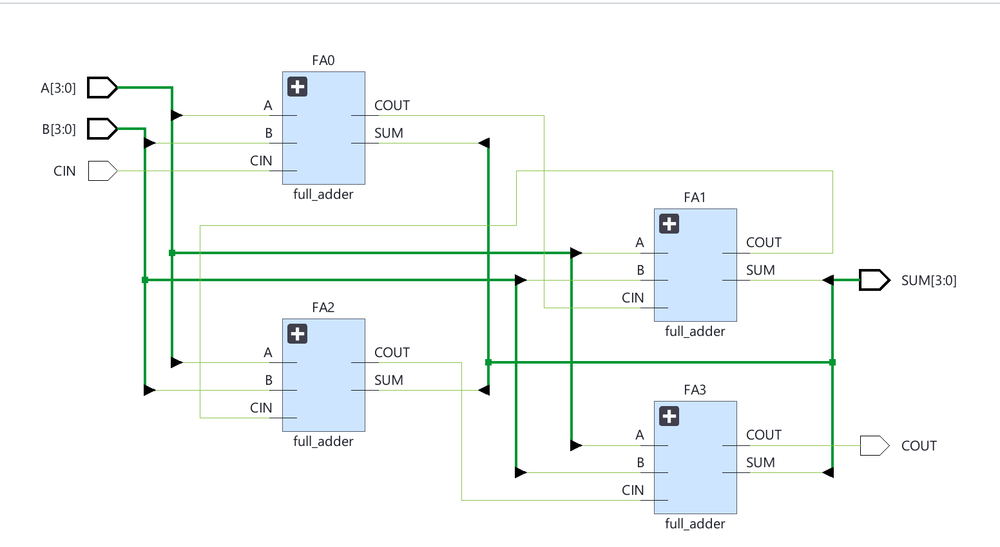
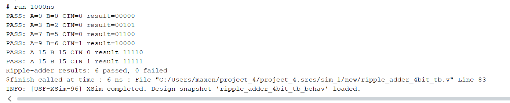
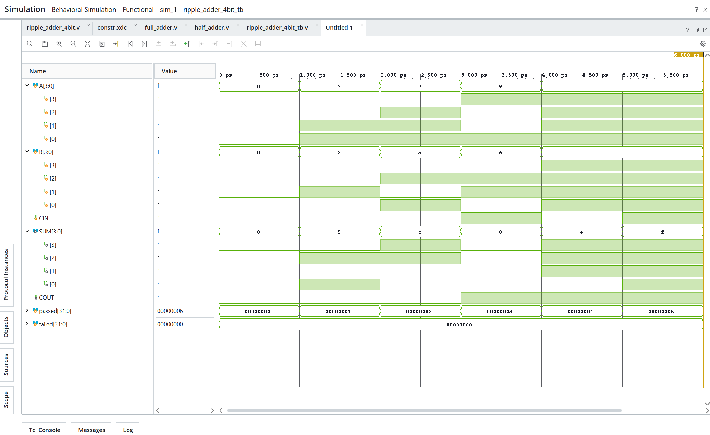
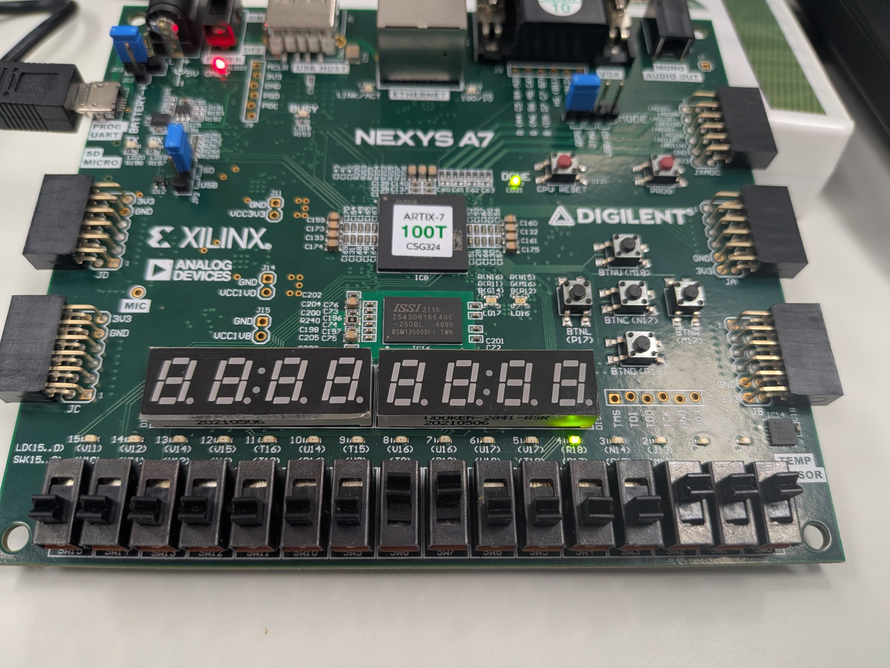
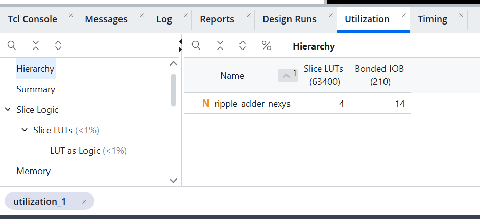

# Laboratory Report Template
## 977-220 Electronics and IoT — Week 3, Slot 9
### Hierarchical Four-Bit Ripple-Carry Adder (Vivado / Nexys A7) — Tasks 3–8

**Student name:** Maxence Dabrowski
**Student ID:** 600103749
**Date:** 11/11/2026

**Laboratory reference:** https://github.com/komsan-k/977-220/tree/main/fpga-2026/week-3/slot-9

> Complete **Tasks 3, 4, 5, 6, 7, and 8**. Insert your own HDL source files, simulation results, Vivado screenshots, resource reports, hardware test data, and observations. Do not mark an item **PASS** without supporting evidence. Use the actual board master XDC and implemented constraints for pin assignments; do not guess package pins. Record measured utilization rather than expected or invented values.

---

## 1. Achievement

**Learning objectives**

- Build a 4-bit ripple-carry adder hierarchically from **four full-adder instances**.
- Recognize the top-level module and its submodules in Vivado's hierarchy view.
- Trace `CIN → C1 → C2 → C3 → COUT` in the elaborated RTL schematic.
- Verify **at least five distinct addition cases** in Vivado behavioral simulation.
- Implement and test an FPGA design in which **switches supply the operands and LEDs display outputs**.
- Record and interpret **LUT, register/flip-flop, and I/O utilization** from Vivado synthesis reports.

**Achievement summary (5–8 sentences):**  
[Summarize Tasks 3–8: hierarchical construction, module hierarchy, RTL carry chain, simulation results, FPGA switch/LED testing, and synthesis resource utilization. Cite your figures and tables.]

---

## 2. Verilog/SystemVerilog

**Project checklist:**

- [ ] Task 3: `half_adder`, `full_adder`, `ripple_adder_4bit`, and any FPGA top-level HDL used
- [ ] Task 4: Vivado hierarchy screenshot identifying the four full-adder instances
- [ ] Task 5: Elaborated RTL schematic and carry-chain trace
- [ ] Task 6: Testbench, waveform screenshot, and results for at least five addition cases
- [ ] Task 7: Actual XDC constraints, implementation/bitstream evidence, and FPGA switch/LED tests
- [ ] Task 8: Vivado utilization report screenshot and LUT/register/I/O resource table

---

## 3. Results

### Task 3 — Four-Bit Adder (Four Full-Adder Instances)

**Objective:** Implement a 4-bit ripple-carry adder with four instantiated full adders.

**Design interface**

| Signal | Direction | Width | Description |
|---|---|---:|---|
| `A[3:0]` | Input | 4 | First operand |
| `B[3:0]` | Input | 4 | Second operand |
| `CIN` | Input | 1 | Initial carry-in |
| `SUM[3:0]` | Output | 4 | Four-bit sum |
| `COUT` | Output | 1 | Final carry-out |

**Source code — half-adder module:**

```verilog
module half_adder (
    input wire A,
    input wire B,
    output wire SUM,
    output wire CARRY
);
    assign SUM = A ^ B;
    assign CARRY = A & B;
endmodule
```

**Source code — full-adder module built from two half adders:**

```verilog
module full_adder (
    input wire A,
    input wire B,
    input wire CIN,
    output wire SUM,
    output wire COUT
);
    wire sum1;
    wire carry1;
    wire carry2;

    half_adder HA1 (
        .A(A),
        .B(B),
        .SUM(sum1),
        .CARRY(carry1)
    );

    half_adder HA2 (
        .A(sum1),
        .B(CIN),
        .SUM(SUM),
        .CARRY(carry2)
    );

    assign COUT = carry1 | carry2;
endmodule
```

**Source code — top-level 4-bit adder:**

```systemverilog
// Hierarchical 4-bit adder using four full-adder instances.
module ripple_adder_4bit(
    input  wire [3:0] A,
    input  wire [3:0] B,
    input  wire       CIN,
    output wire [3:0] SUM,
    output wire       COUT
);

    wire c1;
    wire c2;
    wire c3;

    full_adder FA0 (
        .A(A[0]),
        .B(B[0]),
        .CIN(CIN),
        .SUM(SUM[0]),
        .COUT(c1)
    );

    full_adder FA1 (
        .A(A[1]),
        .B(B[1]),
        .CIN(c1),
        .SUM(SUM[1]),
        .COUT(c2)
    );

    full_adder FA2 (
        .A(A[2]),
        .B(B[2]),
        .CIN(c2),
        .SUM(SUM[2]),
        .COUT(c3)
    );

    full_adder FA3 (
        .A(A[3]),
        .B(B[3]),
        .CIN(c3),
        .SUM(SUM[3]),
        .COUT(COUT)
    );

endmodule
```

**Nexys A7 XDC constraint file:**  

```tcl
set_property PACKAGE_PIN J15 [get_ports {sw[0]}]
set_property IOSTANDARD LVCMOS33 [get_ports {sw[0]}]
set_property PACKAGE_PIN L16 [get_ports {sw[1]}]
set_property IOSTANDARD LVCMOS33 [get_ports {sw[1]}]
set_property PACKAGE_PIN M13 [get_ports {sw[2]}]
set_property IOSTANDARD LVCMOS33 [get_ports {sw[2]}]
set_property PACKAGE_PIN R15 [get_ports {sw[3]}]
set_property IOSTANDARD LVCMOS33 [get_ports {sw[3]}]
set_property PACKAGE_PIN R17 [get_ports {sw[4]}]
set_property IOSTANDARD LVCMOS33 [get_ports {sw[4]}]
set_property PACKAGE_PIN T18 [get_ports {sw[5]}]
set_property IOSTANDARD LVCMOS33 [get_ports {sw[5]}]
set_property PACKAGE_PIN U18 [get_ports {sw[6]}]
set_property IOSTANDARD LVCMOS33 [get_ports {sw[6]}]
set_property PACKAGE_PIN R13 [get_ports {sw[7]}]
set_property IOSTANDARD LVCMOS33 [get_ports {sw[7]}]
set_property PACKAGE_PIN T8 [get_ports {sw[8]}]
set_property IOSTANDARD LVCMOS33 [get_ports {sw[8]}]

set_property PACKAGE_PIN H17 [get_ports {led[0]}]
set_property IOSTANDARD LVCMOS33 [get_ports {led[0]}]
set_property PACKAGE_PIN K15 [get_ports {led[1]}]
set_property IOSTANDARD LVCMOS33 [get_ports {led[1]}]
set_property PACKAGE_PIN J13 [get_ports {led[2]}]
set_property IOSTANDARD LVCMOS33 [get_ports {led[2]}]
set_property PACKAGE_PIN N14 [get_ports {led[3]}]
set_property IOSTANDARD LVCMOS33 [get_ports {led[3]}]
set_property PACKAGE_PIN R18 [get_ports {led[4]}]
set_property IOSTANDARD LVCMOS33 [get_ports {led[4]}]
```

**Instance and carry mapping**

| Bit stage | Full-adder instance name | Carry input | Carry output |
|---|---|---|---|
| 0 | [name] | `CIN` | `C1` |
| 1 | [name] | `C1` | `C2` |
| 2 | [name] | `C2` | `C3` |
| 3 | [name] | `C3` | `COUT` |

**Structural design checks**

- [ ] Four `full_adder` instances are connected in the correct bit order.
- [ ] `CIN` enters the least significant stage (bit 0).
- [ ] Intermediate carries connect stage 0 → 1 → 2 → 3.
- [ ] `{COUT, SUM}` provides the five-bit unsigned result.
- [ ] The HDL elaborates without missing-module or port-connection errors.

**Task 3 verification summary:** The 4-bit ripple-carry adder is implemented
hierarchically with one `ripple_adder_4bit` top module containing four
`full_adder` instances: `FA0`, `FA1`, `FA2`, and `FA3`. Each full adder is
itself constructed from two `half_adder` instances, so the design reuses the
same verified one-bit building blocks. `CIN` enters `FA0`, and the carry
signals propagate in order through `C1`, `C2`, and `C3` to `COUT`. The sum
outputs are connected to `SUM[0]` through `SUM[3]`, giving the complete
five-bit result `{COUT,SUM}`. Functional addition cases are verified
separately in Task 6.

### Task 4 — Hierarchy Verification

**Objective:** Open the Vivado hierarchy and identify each full-adder instance.

**Figure 1 — Vivado hierarchy:**  

| Hierarchical element | Observed module / instance name | Verified? |
|---|---|---|
| Top-level 4-bit adder |ripple_adder_4bit |Yes |
| Full adder, bit 0 |FA0 |Yes  |
| Full adder, bit 1 |FA1 |Yes |
| Full adder, bit 2 | FA2|Yes|
| Full adder, bit 3 |FA3 |Yes |

**Task 4 observations:** The Vivado hierarchy shows the top-level
`ripple_adder_4bit` module containing four instances of the reusable
`full_adder` module: `FA0`, `FA1`, `FA2`, and `FA3`. Each instance processes
one bit position and uses the same full-adder implementation, while its
connections differ only by the operand bit and carry-chain position. The
hierarchy therefore confirms module reuse and shows exactly four full-adder
instances. Each `full_adder` also contains two `half_adder` instances,
`HA1` and `HA2`.

### Task 5 — RTL Schematic and Carry-Chain Tracing

**Objective:** Inspect the elaborated RTL schematic and trace `CIN → C1 → C2 → C3 → COUT`.

**Figure 2 — Elaborated RTL schematic:**  


| Carry net | Driven by | Connected to | Verified in schematic? |
|---|---|---|---|
| `CIN` | Top-level input | Stage 0 carry-in | Yes |
| `C1` | Stage 0 carry-out | Stage 1 carry-in | Yes |
| `C2` | Stage 1 carry-out | Stage 2 carry-in | Yes |
| `C3` | Stage 2 carry-out | Stage 3 carry-in | Yes |
| `COUT` | Stage 3 carry-out | Top-level output | Yes |

**Task 5 observations:** The schematic shows four `full_adder` blocks,
`FA0`, `FA1`, `FA2`, and `FA3`, connected from the least-significant stage
to the most-significant stage. `CIN` enters `FA0`; the carry output of `FA0`
is connected to the `CIN` input of `FA1`, followed by the equivalent
connections from `FA1` to `FA2` and from `FA2` to `FA3`. The final carry from
`FA3` is exported as `COUT`. The sum outputs from the four stages are
combined into the `SUM[3:0]` bus. This confirms the ripple-carry path
`CIN → C1 → C2 → C3 → COUT`. The HDL describes named intermediate carry
nets, while the elaborated schematic displays the same connections as
graphical wires and buses; the logical structure is unchanged.

### Task 6 — Behavioral Simulation (At Least Five Addition Cases)

**Objective:** Simulate the hierarchical 4-bit ripple-carry adder in Vivado and verify at least five distinct additions. The expected **five-bit unsigned result** is

$$
\{COUT,SUM\}=A+B+CIN.
$$

**Simulation setup**  
Testbench file: `ripple_adder_4bit_tb.v`  
Design under test (DUT): `ripple_adder_4bit`  
Simulation tool / Vivado version: Vivado XSim 2026.1  
Simulation duration: `1000 ns`

**Testbench source code:**

```verilog
`timescale 1ns/1ps

module ripple_adder_4bit_tb;
    reg [3:0] A;
    reg [3:0] B;
    reg CIN;
    wire [3:0] SUM;
    wire COUT;
    integer passed;
    integer failed;

    ripple_adder_4bit dut (
        .A(A), .B(B), .CIN(CIN),
        .SUM(SUM), .COUT(COUT)
    );

    task check_case;
        input [3:0] test_a;
        input [3:0] test_b;
        input test_cin;
        input [4:0] expected;
        begin
            A = test_a;
            B = test_b;
            CIN = test_cin;
            #1;
            if ({COUT, SUM} === expected) begin
                passed = passed + 1;
                $display("PASS: A=%0d B=%0d CIN=%b result=%b",
                         A, B, CIN, {COUT, SUM});
            end
            else begin
                failed = failed + 1;
                $display("FAIL: A=%0d B=%0d CIN=%b expected=%b actual=%b",
                         A, B, CIN, expected, {COUT, SUM});
            end
        end
    endtask

    initial begin
        $dumpfile("ripple_adder_4bit.vcd");
        $dumpvars(0, ripple_adder_4bit_tb);
        passed = 0;
        failed = 0;

        check_case(4'd0,  4'd0,  1'b0, 5'b00000);
        check_case(4'd3,  4'd2,  1'b0, 5'b00101);
        check_case(4'd7,  4'd5,  1'b0, 5'b01100);
        check_case(4'd9,  4'd6,  1'b1, 5'b10000);
        check_case(4'd15, 4'd15, 1'b0, 5'b11110);
        check_case(4'd15, 4'd15, 1'b1, 5'b11111);

        $display("Ripple-adder results: %0d passed, %0d failed",
                 passed, failed);
        $finish;
    end
endmodule
```


**Simulation results — record the observed outputs**

| Test | A (decimal) | B (decimal) | CIN | Expected decimal result | Expected `{COUT,SUM}` (5 bits) | Simulated `{COUT,SUM}` | Pass/Fail |
|---:|---:|---:|:---:|---:|:---:|:---:|:---:|
| 1 | 0 | 0 | 0 | 0 | `00000` | `00000` | Pass |
| 2 | 3 | 2 | 0 | 5 | `00101` | `00101` | Pass |
| 3 | 7 | 5 | 0 | 12 | `01100` | `01100` | Pass |
| 4 | 9 | 6 | 1 | 16 | `10000` | `10000` | Pass |
| 5 | 15 | 15 | 0 | 30 | `11110` | `11110` | Pass |
| 6 (optional) | 15 | 15 | 1 | 31 | `11111` | `11111` | Pass |
| 7 (custom) | | | | | | | |

**Figure 3 — Vivado behavioral simulation waveform:**  
[Insert a screenshot showing `A`, `B`, `CIN`, `SUM`, `COUT`, and time markers for at least five test cases. Include intermediate carry nets if available.]



**Simulation evidence checklist**

- [x] Testbench compiled and simulation completed.
- [x] At least five distinct test cases are visible in the waveform or test log.
- [x] Each observed five-bit result was compared against `A + B + CIN`.
- [x] A case producing `COUT = 1` was included.
- [x] Any mismatch was documented and investigated.

**Task 6 observations:** The Vivado XSim console shows six passing test
cases and zero failures. The `0+0+0` case verifies the zero result, while
`3+2+0` verifies ordinary addition. The `7+5+0` vector exercises internal
carry propagation through the four full-adder stages shown in the RTL
schematic. The `9+6+1` vector produces `16`, confirming that the final carry
is included in `{COUT,SUM}=10000`. The maximum cases `15+15+0` and
`15+15+1` verify the carry-out boundary and produce `11110` and `11111`.
The console reports `6 passed, 0 failed`, and XSim completed successfully.

### Task 7 — FPGA Implementation (Switches and LEDs)

**Objective:** Use onboard switches for operand inputs and onboard LEDs for output display.

**Board identification**  
Board: Artix-7
FPGA device / part: xc7a100tcsg324-1
Clock requirement (if any): None; the adder is combinational.

**Switch/LED mapping — fill from your actual XDC constraints**

| HDL signal | Physical control/indicator | FPGA package pin | I/O standard |
|---|---|---|---|
| `A[0]` | SW0 | J15 | LVCMOS33 |
| `A[1]` | SW1 | L16 | LVCMOS33 |
| `A[2]` | SW2 | M13 | LVCMOS33 |
| `A[3]` | SW3 | R15 | LVCMOS33 |
| `B[0]` | SW4 | R17 | LVCMOS33 |
| `B[1]` | SW5 | T18 | LVCMOS33 |
| `B[2]` | SW6 | U18 | LVCMOS33 |
| `B[3]` | SW7 | R13 | LVCMOS33 |
| `CIN` | SW8 | T8 | LVCMOS33 |
| `SUM[0]` | LED0 | H17 | LVCMOS33 |
| `SUM[1]` | LED1 | K15 | LVCMOS33 |
| `SUM[2]` | LED2 | J13 | LVCMOS33 |
| `SUM[3]` | LED3 | N14 | LVCMOS33 |
| `COUT` | LED4 | R18 | LVCMOS33 |

```tcl
set_property PACKAGE_PIN J15 [get_ports {sw[0]}]
set_property IOSTANDARD LVCMOS33 [get_ports {sw[0]}]

set_property PACKAGE_PIN L16 [get_ports {sw[1]}]
set_property IOSTANDARD LVCMOS33 [get_ports {sw[1]}]

set_property PACKAGE_PIN M13 [get_ports {sw[2]}]
set_property IOSTANDARD LVCMOS33 [get_ports {sw[2]}]

set_property PACKAGE_PIN R15 [get_ports {sw[3]}]
set_property IOSTANDARD LVCMOS33 [get_ports {sw[3]}]

set_property PACKAGE_PIN R17 [get_ports {sw[4]}]
set_property IOSTANDARD LVCMOS33 [get_ports {sw[4]}]

set_property PACKAGE_PIN T18 [get_ports {sw[5]}]
set_property IOSTANDARD LVCMOS33 [get_ports {sw[5]}]

set_property PACKAGE_PIN U18 [get_ports {sw[6]}]
set_property IOSTANDARD LVCMOS33 [get_ports {sw[6]}]

set_property PACKAGE_PIN R13 [get_ports {sw[7]}]
set_property IOSTANDARD LVCMOS33 [get_ports {sw[7]}]

set_property PACKAGE_PIN T8 [get_ports {sw[8]}]
set_property IOSTANDARD LVCMOS33 [get_ports {sw[8]}]

set_property PACKAGE_PIN H17 [get_ports {led[0]}]
set_property IOSTANDARD LVCMOS33 [get_ports {led[0]}]

set_property PACKAGE_PIN K15 [get_ports {led[1]}]
set_property IOSTANDARD LVCMOS33 [get_ports {led[1]}]

set_property PACKAGE_PIN J13 [get_ports {led[2]}]
set_property IOSTANDARD LVCMOS33 [get_ports {led[2]}]

set_property PACKAGE_PIN N14 [get_ports {led[3]}]
set_property IOSTANDARD LVCMOS33 [get_ports {led[3]}]

set_property PACKAGE_PIN R18 [get_ports {led[4]}]
set_property IOSTANDARD LVCMOS33 [get_ports {led[4]}]
```

**Implementation evidence**

| Step | Evidence / observation | Status |
|---|---|---|
| Run synthesis | Completed before bitstream generation | Pass |
| Run implementation | Completed before bitstream generation | Pass |
| Generate bitstream | Bitstream generated successfully | Pass |
| Program FPGA | Board programmed with the generated bitstream | Pass |
| Test switches/LEDs | Addition results observed on the LEDs | Pass |

**Hardware verification results**

| A (decimal) | B (decimal) | CIN | Expected `{COUT,SUM}` | Observed LED output | Pass/Fail |
|---:|---:|:---:|:---:|:---:|:---:|
| 0 | 0 | 0 | `00000` | `00000` | Pass |
| 3 | 5 | 0 | `01000` | `01000` | Pass |
| 7 | 8 | 1 | `10000` | `10000` | Pass |
| 15 | 15 | 0 | `11110` | `11110` | Pass |
| 15 | 15 | 1 | `11111` | `11111` | Pass |

**Figure 4 — FPGA programmed in Hardware Manager:**  
The FPGA was programmed successfully before the switch and LED tests.

**Figure 5 — FPGA switch-and-LED test:**  

Test for A=7 B=8 and CIN=1

**Task 7 observations:** The physical Nexys A7 results matched the expected
additions for all tested cases. The `ripple_adder_nexys` wrapper was
used because the XDC constrains the physical ports `sw[8:0]` and `led[4:0]`.
`LED4` displays the carry bit and `LED3:LED0` display `SUM[3:0]`. After using
the corrected wrapper and bit-by-bit XDC constraints, no pin-mapping or
carry-interpretation issue remained.

### Task 8 — FPGA Resource Analysis

**Objective:** Record and interpret FPGA resource utilization after running Vivado synthesis, especially **LUT, register/flip-flop, and I/O utilization**, as required by the laboratory instructions.

**Report identification**  
Vivado report name / location: `utilization_1`  
FPGA device / part: Artix-7 `xc7a100tcsg324-1`  
Synthesis top module: `ripple_adder_nexys`  
Synthesis run status: Completed successfully  

**Resource utilization — transcribe values from the actual Vivado report**

| Resource | Used | Available (if reported) | Utilization (%) (if reported) | Evidence / report row |
|---|---:|---:|---:|---|
| LUTs | 4 Slice LUTs | 63,400 | <1% | Utilization hierarchy |
| Registers / flip-flops | 0 | 126,800 | 0% | Combinational design |
| I/O ports or I/O buffers | 14 Bonded IOBs | 210 | 6.67% | Utilization hierarchy |
| BRAM (if reported) | | | | |
| DSP slices (if reported) | | | | |

**Figure 6 — Vivado synthesis utilization report:**  


**Resource interpretation**

| Question | Student observation / explanation |
|---|---|
| How many LUTs were used? | 4 Slice LUTs, less than 1% of the available LUTs. |
| How many registers/flip-flops were used? | 0; the adder has no clocked or state-holding logic. |
| How many I/O resources were used? | 14 Bonded IOBs, corresponding to 9 switches and 5 LEDs. |
| Is the design combinational or sequential? How does this affect register use? | It is combinational, so no flip-flops are required. |
| Did synthesis preserve the HDL hierarchy or optimize/flatten some modules? | The utilization hierarchy identifies `ripple_adder_nexys`; synthesis may optimize internal half/full-adder hierarchy while preserving the function. |
| What FPGA logic resources appear to implement carry propagation? (If visible) | The four LUTs implement the remaining logic; Vivado may map carry propagation into dedicated carry resources, although the capture does not show a separate carry-resource row. |

**Optional timing observation (only if a meaningful timing report is available):**  
Critical path / delay: ____________________  
Report and constraint assumptions: ____________________  

> **Reporting note:** This ripple-carry adder is a combinational circuit, so register utilization may be zero. Record what Vivado actually reports. Do not infer a maximum clock frequency from an unconstrained combinational path; if timing is discussed, identify the constraints and report used.

**Task 8 observations:** The Vivado utilization report shows that
`ripple_adder_nexys` uses 4 Slice LUTs and 14 Bonded IOBs, with both values
below 1% of the available device resources where applicable. The 14 I/O
resources match the nine switch inputs and five LED outputs in the wrapper.
No registers are required because the ripple-carry adder is combinational.
The low LUT count reflects synthesis optimization of the hierarchical
half-adder/full-adder logic. These values are taken from the utilization
hierarchy shown in Figure 6.

---

## 4. Discussion

Answer using **your actual results and screenshots**, not only theoretical descriptions.

1. A 4-bit adder is constructed from four full-adder instances because each
   instance performs the same one-bit operation and accepts a carry input.
   This hierarchical structure is reusable, easier to verify, and clearly
   separates the one-bit building block from the four-bit datapath.

2. `CIN` enters the least-significant full adder, `FA0`. Its carry output is
   `C1`, which drives the carry input of `FA1`. The next stages pass the carry
   through `C2` and `C3`; the carry output of `FA3` is the final `COUT`.
   Therefore, the carry path is `CIN → C1 → C2 → C3 → COUT`.

3. Vivado's Sources/Hierarchy view demonstrates module reuse by showing one
   top-level `ripple_adder_4bit` module containing four instances of the same
   `full_adder` module. The instances correspond to bit positions 0, 1, 2,
   and 3, rather than four separately written adder implementations.

4. The elaborated schematic confirms the ripple-carry architecture by showing
   four cascaded full-adder stages. The carry output of each lower-order stage
   connects to the carry input of the next higher-order stage, while the
   four sum outputs connect to `SUM[3:0]` and the last carry connects to
   `COUT`.

5. `{COUT, SUM}` is a five-bit result because adding two four-bit unsigned
   operands can produce a value from 0 to 31. `SUM[3:0]` contains only the
   lower four bits; `COUT` contains the fifth, most-significant carry bit.
   For example, `15 + 15 + 1 = 31 = 5'b11111`.

6. The listed Task 6 vectors cover ordinary addition, carry propagation, and
   final carry-out:

   | A | B | CIN | Expected `{COUT,SUM}` | Purpose |
   |---:|---:|:---:|:---:|---|
   | 0 | 0 | 0 | `00000` | Zero result |
   | 3 | 2 | 0 | `00101` | Ordinary addition |
   | 7 | 5 | 0 | `01100` | Internal carry propagation |
   | 9 | 6 | 1 | `10000` | Input carry and final carry-out |
   | 15 | 15 | 0 | `11110` | Maximum operands with carry-out |
   | 15 | 15 | 1 | `11111` | Optional maximum five-bit result |

   These results are the expected values from `A+B+CIN`; the actual waveform
   or testbench log should be cited as the experimental evidence.

7. The operand switches should be assigned to `A[3:0]`, `B[3:0]`, and `CIN`
   according to the actual XDC file. The result LEDs should be assigned to
   `SUM[3:0]` and `COUT`, with the LED for `COUT` identified separately so
   that a fifth result bit is not mistaken for part of `SUM`. The current
   report does not yet include the actual XDC pin assignments, so specific
   package pins cannot be confirmed here.

8. The current report does not contain a Hardware Manager screenshot or
   completed observed-LED column, so physical agreement cannot be independently
   confirmed from the available evidence. The board result matches the
   behavioral simulation when each observed LED pattern equals the corresponding
   five-bit value in the Task 7 table, including `11110` for `15+15` and
   `11111` for `15+15+1`.

9. Incorrect XDC mappings can connect a signal to the wrong switch or LED,
   leave a port unconstrained, or cause DRC and bitstream-generation errors.
   Missing carry connections produce incorrect sums whenever a lower stage
   generates a carry. Selecting the wrong top module can omit the intended
   ports, compile a testbench as hardware, or generate a bitstream that does
   not match the expected switch and LED interface.

10. In a ripple-carry adder, each stage may need to wait for the carry from the
    previous stage before its sum and carry outputs become stable. As the
    width increases, more stages are placed in series, so the worst-case
    propagation delay generally increases approximately with the number of
    stages. Faster dedicated carry resources can reduce the practical delay,
    but the serial carry dependency remains.

11. The current report has no Vivado utilization screenshot or transcribed
    utilization table, so the actual LUT, register, and I/O values are not
    available here. These values must be copied from the implemented
    `Report Utilization` output rather than estimated. The I/O count should
    correspond to the constrained operand and result ports.

12. The adder is combinational: it has no clock and no state-holding
    assignments. Therefore, Vivado can implement its logic using LUTs and
    dedicated carry resources without using flip-flops, even though the
    hierarchical HDL contains several module instances.

13. Yes. Synthesis may flatten or optimize the four full-adder modules,
    combine equivalent logic, or map the carry path to dedicated FPGA carry
    primitives. These changes can make the post-synthesis hierarchy look
    different from the RTL hierarchy while preserving the same truth table
    and `{COUT,SUM}` function. The RTL schematic should be used to verify the
    source structure, while the utilization report reflects the optimized
    implementation.
