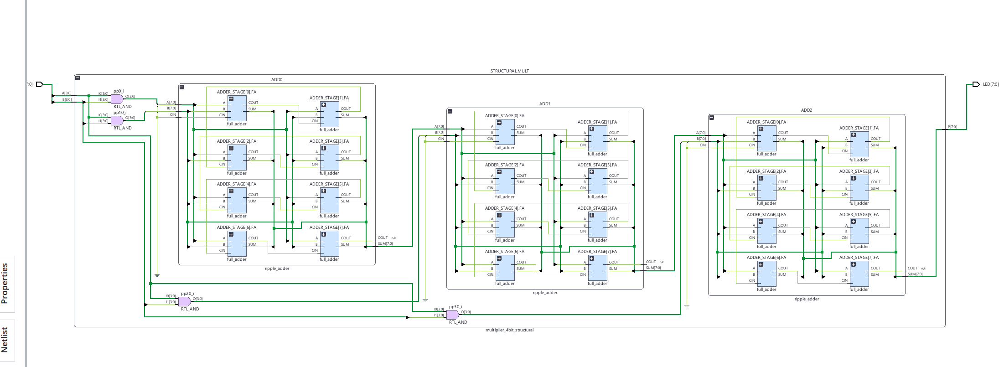
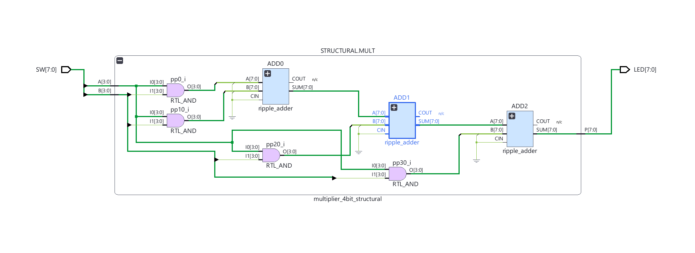
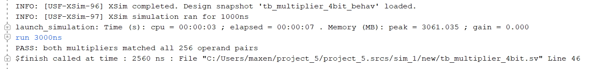
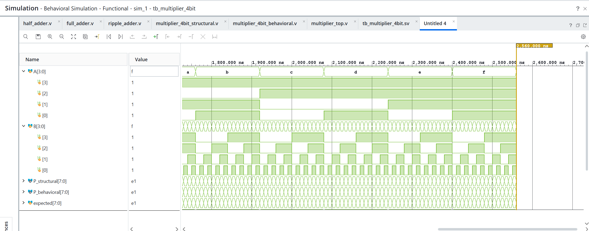

# Laboratory Report Template
## 977-220 Electronics and IoT — Week 3, Slot 10: Multiplier Study Case

**Reference:** https://github.com/komsan-k/977-220/tree/main/fpga-2026/week-3/slot-10  
**Student name:** Maxence Dabrowski  
**Student ID:** 6900103749  
**Date:** 12/11/2026  
**Vivado version / target FPGA:** 2026.1

> **Scope:** Complete Tasks **3–6**. Record results from your own implementation; do not replace experimental evidence with expected values.

---

## 1. Achievement

After completing this lab, I can:

- Construct four shifted partial-product rows for a **4 × 4-bit unsigned multiplier**.
- Explain how binary multiplication produces an **8-bit product**.
- Connect **three ripple-carry adders** to sum the partial-product rows.
- Implement an equivalent multiplier using the Verilog/SystemVerilog `*` operator.
- Build or run an **exhaustive testbench for 16 × 16 = 256 input pairs**.
- Compare the structural and multiplication-operator designs using simulation results.

**Achievement summary (4–6 sentences):**

[Describe what you implemented, tested, and learned.]

---

## 2. Verilog/SystemVerilog 


**Project file checklist:**

- [ ] Full-adder / ripple-adder source modules
- [ ] Structural four-bit multiplier source module
- [ ] `*`-operator multiplier source module
- [ ] Exhaustive testbench source
- [ ] Simulation screenshots or log
- [ ] README describing how to reproduce the results

---

## 3. Results

### Task 3 — Four Shifted Partial-Product Rows

**Objective:** Construct the four partial-product rows and manually verify **11 × 5**.

For unsigned inputs `A[3:0]` and `B[3:0]`, the rows correspond to `A & {4{B[i]}}`, shifted left by `i` for `i = 0,1,2,3`. Use **8-bit alignment** in the report.

**Input operands:**

- `A = 11 = 4'b1011`
- `B = 5  = 4'b0101`

**Manual partial-product calculation:**

| Row | Multiplier bit | 4-bit partial product (before shifting) | 8-bit shifted row |
|---|---|---|---|
| `PP0` | `B[0] = 1` | `1011` | `00001011` |
| `PP1` | `B[1] = 0` | `0000` | `00000000` |
| `PP2` | `B[2] = 1` | `1011` | `00101100` |
| `PP3` | `B[3] = 0` | `0000` | `00000000` |
| **Sum** | | | **`00110111` = 55** |

**Handwritten calculation / annotated figure:**

The aligned binary addition is:

```text
    00001011
    00000000
    00101100
    00000000
    --------
    00110111 = 55
```

**RTL used to generate partial products (if applicable):**

```verilog
module partial_product_rows (
    input wire [3:0] A,
    input wire [3:0] B,
    output wire [7:0] PP0,
    output wire [7:0] PP1,
    output wire [7:0] PP2,
    output wire [7:0] PP3
);
    assign PP0 = {4'b0000, (A & {4{B[0]}})};
    assign PP1 = {3'b000, (A & {4{B[1]}}), 1'b0};
    assign PP2 = {2'b00, (A & {4{B[2]}}), 2'b00};
    assign PP3 = {1'b0, (A & {4{B[3]}}), 3'b000};
endmodule
```

**Verification:** Expected product = `8'b00110111` = **55**.  
**Your simulated result:** `8'b00110111` = **55**  
**Status:** [x] PASS  [ ] FAIL

**Observation:** `PP1` and `PP3` are zero because `B[1]` and `B[3]` are
zero, so those multiplier bits select no copy of `A`. `PP2` contains `A`
because `B[2]=1`, and it is shifted left by two positions because it
represents the coefficient `2^2`. Similarly, `PP0` is unshifted because it
represents the coefficient `2^0`. The four rows are zero-extended to eight
bits before addition.

### Task 4 — Three Ripple Adders for the Structural Multiplier

**Objective:** Instantiate **three ripple-carry adders** to sum the four aligned partial-product rows.

**Hierarchy / architecture:**

```text
A[3:0], B[3:0]
       |
  Partial-product generation
       |
  PP0  PP1  PP2  PP3   (each zero-extended/shifted to 8 bits)
    \  /      |    |
   Ripple Adder 1   |
         |      |   |
    Ripple Adder 2  |
           |        |
      Ripple Adder 3
           |
        P[7:0]
```

**Design/source modules:**

```systemverilog
module ripple_adder #(
    parameter integer N = 8
)(
    input  wire [N-1:0] A,
    input  wire [N-1:0] B,
    input  wire         CIN,
    output wire [N-1:0] SUM,
    output wire         COUT
);
    wire [N:0] carry;
    assign carry[0] = CIN;
    assign COUT = carry[N];

    genvar i;
    generate
        for (i = 0; i < N; i = i + 1) begin : ADDER_STAGE
            full_adder FA (
                .A(A[i]), .B(B[i]), .CIN(carry[i]),
                .SUM(SUM[i]), .COUT(carry[i+1])
            );
        end
    endgenerate
endmodule

module half_adder (
    input  wire A,
    input  wire B,
    output wire SUM,
    output wire CARRY
);
    assign SUM   = A ^ B;
    assign CARRY = A & B;
endmodule

module full_adder (
    input  wire A,
    input  wire B,
    input  wire CIN,
    output wire SUM,
    output wire COUT
);
    wire sum1, carry1, carry2;

    half_adder HA1 (
        .A(A), .B(B), .SUM(sum1), .CARRY(carry1)
    );
    half_adder HA2 (
        .A(sum1), .B(CIN), .SUM(SUM), .CARRY(carry2)
    );

    assign COUT = carry1 | carry2;
endmodule

module multiplier_4bit_structural (
    input  wire [3:0] A,
    input  wire [3:0] B,
    output wire [7:0] P
);
    wire [7:0] pp0, pp1, pp2, pp3;
    wire [7:0] sum01, sum012;
    wire carry01, carry012, carry_final;

    assign pp0 = {4'b0000, (A & {4{B[0]}})};
    assign pp1 = {3'b000,  (A & {4{B[1]}}), 1'b0};
    assign pp2 = {2'b00,   (A & {4{B[2]}}), 2'b00};
    assign pp3 = {1'b0,    (A & {4{B[3]}}), 3'b000};

    ripple_adder #(.N(8)) ADD0 (
        .A(pp0), .B(pp1), .CIN(1'b0),
        .SUM(sum01), .COUT(carry01)
    );
    ripple_adder #(.N(8)) ADD1 (
        .A(sum01), .B(pp2), .CIN(1'b0),
        .SUM(sum012), .COUT(carry012)
    );
    ripple_adder #(.N(8)) ADD2 (
        .A(sum012), .B(pp3), .CIN(1'b0),
        .SUM(P), .COUT(carry_final)
    );
endmodule


module multiplier_top #(
    parameter integer USE_STRUCTURAL = 1
)(
    input  wire [7:0] SW,
    output wire [7:0] LED
);
    generate
        if (USE_STRUCTURAL != 0) begin : STRUCTURAL
            multiplier_4bit_structural MULT (
                .A(SW[3:0]), .B(SW[7:4]), .P(LED)
            );
        end else begin : BEHAVIORAL
            multiplier_4bit_behavioral MULT (
                .A(SW[3:0]), .B(SW[7:4]), .P(LED)
            );
        end
    endgenerate
endmodule

// Identify all three ripple-adder instantiations.
```

**Hierarchy evidence:**



**Intermediate arithmetic verification:**

| Stage | Operation | Expected 8-bit result | Simulated result | Pass/Fail |
|---|---|---|---|---|
| Adder 1 | `PP0 + PP1` | `00001011` |00001011 | Pass|
| Adder 2 | `(PP0+PP1) + PP2` | `00110111` |00110111 |Pass |
| Adder 3 | `previous + PP3` | `00110111` |00110111 |Pass |

**Final structural product for 11 × 5:** 00110111
**Status:** [X] PASS  [ ] FAIL

**Discussion of carry propagation:** [Identify which adder signals carry intermediate results, and explain how the final 8-bit product is formed.]

### Task 5 — Multiplication-Operator Version

**Objective:** Implement the equivalent unsigned 4 × 4 multiplier using `*`.

**RTL source:**

```verilog
module multiplier_4bit_behavioral (
    input wire [3:0] A,
    input wire [3:0] B,
    output wire [7:0] P
);
    assign P = A * B;
endmodule
```

**Selected functional comparisons:**

| A (decimal) | B (decimal) | Expected product (decimal) | Structural result | `*` result | Both pass? |
|---:|---:|---:|---|---|---|
| 0 | 0 | 0 | `00000000` (0) | `00000000` (0) | Yes |
| 1 | 15 | 15 | `00001111` (15) | `00001111` (15) | Yes |
| 3 | 7 | 21 | `00010101` (21) | `00010101` (21) | Yes |
| 5 | 11 | 55 | `00110111` (55) | `00110111` (55) | Yes |
| 11 | 5 | 55 | `00110111` (55) | `00110111` (55) | Yes |
| 15 | 15 | 225 | `11100001` (225) | `11100001` (225) | Yes |

**Simulation waveform screenshot:**

The comparative simulation must use `tb_multiplier_4bit` as the simulation
top. Do not run `multiplier_top` by itself because its `SW[7:0]` inputs are
not driven in simulation and appear as `Z`, producing unknown outputs. The
structural RTL schematic is shown in  and the
multiplier-level view in .

**Comparison (3–5 sentences):**

The structural version explicitly exposes the four partial-product rows and
the three ripple-adder stages, making the carry path and module hierarchy
visible. The `*`-operator version is much shorter and easier to read because
the multiplication operation is expressed directly. For every selected test
case, both versions produce the same eight-bit unsigned product. A resource
or timing advantage is not claimed because no comparative synthesis report is
included.

### Task 6 — Exhaustive Testbench: All 256 Operand Pairs

**Objective:** Test every unsigned four-bit pair: `A = 0…15`, `B = 0…15`.

**Testbench source:**

```systemverilog
`timescale 1ns / 1ps

module tb_multiplier_4bit;
    reg  [3:0] A, B;
    wire [7:0] P_structural, P_behavioral;
    reg  [7:0] expected;
    integer a_value, b_value;
    integer tests, errors;

    multiplier_4bit_structural DUT_S (
        .A(A), .B(B), .P(P_structural)
    );
    multiplier_4bit_behavioral DUT_B (
        .A(A), .B(B), .P(P_behavioral)
    );

    initial begin
        A = 0;
        B = 0;
        tests = 0;
        errors = 0;

        for (a_value = 0; a_value < 16; a_value = a_value + 1) begin
            for (b_value = 0; b_value < 16; b_value = b_value + 1) begin
                A = a_value[3:0];
                B = b_value[3:0];
                expected = a_value * b_value;
                #10;
                tests = tests + 1;

                if ((P_structural !== expected) ||
                    (P_behavioral !== expected)) begin
                    errors = errors + 1;
                    $display("FAIL: A=%0d B=%0d expected=%0d S=%0d B=%0d",
                             A, B, expected, P_structural, P_behavioral);
                end
            end
        end

        if (errors != 0)
            $fatal(1, "FAIL: %0d errors in %0d operand pairs", errors, tests);

        $display("PASS: both multipliers matched all %0d operand pairs", tests);
        $finish;
    end
endmodule
```


**Verification checklist:**

- [x] All values of A from 0 to 15 tested
- [x] All values of B from 0 to 15 tested for each A
- [x] Total checked cases = 256
- [x] Expected result computed with sufficient width (8 bits)
- [x] Both structural and `*` results checked
- [x] No unknown (`X`) or high-impedance (`Z`) products overlooked
- [x] PASS/FAIL summary printed to the simulation console

**Simulation summary:**

| Verification metric | Reported value |
|---|---|
| Total input pairs executed | 256 |
| Structural multiplier passes | 256 |
| Structural multiplier failures | 0 |
| `*` multiplier passes | 256 |
| `*` multiplier failures | 0 |
| Structural vs operator mismatches | 0 |
| Final conclusion | PASS |

**Simulation console screenshot:**



**Waveform screenshot:**


**Failure details (only if applicable):**

| A | B | Expected | Structural | Operator | Suspected cause / fix |
|---|---|---|---|---|---|
| | | | | | |

### Overall Result Summary

| Task | Deliverable | Evidence included | PASS/FAIL |
|---|---|---|---|
| 3 | Four shifted rows; manual 11 × 5 | Calculation + check |PASS |
| 4 | Three ripple-adder instances | HDL + hierarchy + intermediate checks |PASS |
| 5 | Multiplication-operator multiplier | HDL + comparative simulation | PASS |
| 6 | Exhaustive 256-pair verification | Testbench + console log + waveform | PASS |

---

## 4. Discussion

Answer with evidence from your implementation and simulation.

1. A 4-bit multiplier has four multiplier bits, `B[0]` through `B[3]`.
   Each bit selects one copy of `A`, so one partial-product row is required
   for each multiplier bit. Each selected row is shifted according to the
   bit position before the rows are added.

2. The largest unsigned 4-bit operand is 15. The largest product is therefore
   `15 × 15 = 225`, which is `11100001` in binary. Since 225 is larger than
   the maximum 7-bit value, the product requires eight bits.

3. For `A=1011` (11) and `B=0101` (5), the multiplier has `B[0]=1` and
   `B[2]=1`, while `B[1]=0` and `B[3]=0`:

   ```text
       00001011   (1011 × B[0])
       00000000   (1011 × B[1], shifted by 1)
       00101100   (1011 × B[2], shifted by 2)
       00000000   (1011 × B[3], shifted by 3)
       --------
       00110111   = 55
   ```

4. Three adders are sufficient because adding four rows can be performed as a
   chain of three binary additions: `PP0 + PP1`, then the first result plus
   `PP2`, and finally the second result plus `PP3`. Each adder reduces the
   number of remaining rows by one.

5. Carry propagation transfers a carry generated at a lower bit position to
   the next higher bit position. In each ripple-carry adder, the carry-out of
   one full-adder stage becomes the carry-in of the next stage. This ensures
   that every bit of the intermediate eight-bit sum is calculated correctly.

6. The structural multiplier explicitly creates the four partial-product rows
   and instantiates three ripple adders, making the datapath and carry
   propagation visible in the hierarchy. The `*`-operator version expresses
   the same unsigned multiplication in one concise assignment, leaving
   Vivado to infer the implementation. Both descriptions should implement
   the same function, but their hierarchy and RTL complexity are different.

7. Both implementations should produce identical products for all 256 input
   pairs because both calculate the unsigned operation `A × B`. The actual
   claim of `256` passes and `0` mismatches must be supported by the Task 6
   console output or testbench summary; no such output is currently included
   in this report.

8. Exhaustive verification is practical because a 4-bit operand has only 16
   possible values. Testing all combinations requires only `16 × 16 = 256`
   cases, which completes quickly in simulation and provides complete
   functional coverage for the input space.

9. Useful tests include `0×0` and `0×15` for zero handling, `1×15` for
   bit-width and shifting, `3×7` for ordinary partial products, `5×11` and
   `11×5` for multiple shifted rows, and `15×15` for the maximum product.
   Cases such as `7×8` and `15×15` are especially useful for detecting
   carry-propagation and truncated-output errors.

10. For an 8×8 multiplier, I would generate eight 16-bit partial-product
    rows and use an adder tree or a wider structured adder network to sum
    them. All operands, intermediate carries, and the final product would be
    widened to 16 bits. The exhaustive testbench would then cover
    `256 × 256 = 65,536` pairs, or use directed plus randomized tests if
    simulation time became significant.
