# Laboratory Report Template
## 977-220 Electronics and IoT — Topic 11: Vivado-7
### Fixed-Point Multipliers — Combinational Verilog and FPGA Implementation (Nexys A7)

**Student name:** Maxence Dabrowski  
**Student ID:** 6900103749  
**Date:** 12/11/2026  


**Laboratory reference:** *Topic 11: Vivado-7 — Fixed-Point Multipliers* (revised, non-pipelined laboratory).

> **Required work:** Complete **Tasks 1–8, including Task 7 — FPGA Implementation**. Use your own calculations, Verilog files, Vivado screenshots, board photos, and measured results. Do not mark PASS without evidence. This is a **combinational** multiplier: no pipeline, clock, reset, or valid signals are used in the datapath. Obtain exact package pins from the **official master XDC for your actual board**; do not guess pin numbers.

---

## 1. Achievement

**Learning objectives**

- Encode signed 8-bit **Q3.4** numbers (1 sign bit, 3 non-sign integer bits, 4 fractional bits).
- Design a signed 8 × 8 multiplier with a **16-bit signed raw product**.
- Rescale the raw product using **arithmetic right shift `>>> 4`**.
- Clamp the result to the signed 8-bit range using **saturation**.
- Verify the combinational circuit using Vivado simulation and an RTL schematic.
- Implement the design on **Nexys A7**, using switches for both operands and LEDs for the product and saturation flag.
- Record and interpret Vivado synthesis resource utilization.

**Achievement summary (5–8 sentences):**  
[Summarize the Verilog design, Q3.4 calculations, simulation, FPGA programming, observed LED outputs, and synthesis results.]

---

## 2. Verilog and FPGA Project

### 2.1 Project information

| Item | Student entry |
|---|---|
| Vivado project name | Week3_lab3|
| Vivado version |2026.1 |
| Board and FPGA part | |
| Simulation top module | `tb_fixed_point_multiplier` |
| FPGA synthesis top module | `fixed_point_top` |
| Design files | `signed_multiplier.v`, `fixed_point_multiplier.v`, `fixed_point_top.v` |
| Simulation file | `tb_fixed_point_multiplier.v` |
| Constraint file | [Actual board XDC filename] |

**Source / evidence checklist**

- [ ] `signed_multiplier.v` — basic signed multiplication
- [ ] `fixed_point_multiplier.v` — arithmetic shift and saturation
- [ ] `tb_fixed_point_multiplier.v` — behavioral simulation
- [ ] `fixed_point_top.v` — switches and LEDs wrapper
- [ ] Official board XDC adapted to the actual top-level port names
- [ ] Simulation waveform and test results
- [ ] Elaborated RTL schematic
- [ ] Synthesis and implementation reports
- [ ] Generated bitstream and programmed FPGA
- [ ] Hardware test photographs / observations

### 2.2 Design interface

| Module | Input | Output | Purpose |
|---|---|---|---|
| `signed_multiplier` | `A[7:0]`, `B[7:0]` signed | `PRODUCT[15:0]` signed | Full raw product |
| `fixed_point_multiplier` | `A[7:0]`, `B[7:0]` signed | `P[7:0]` signed, `SATURATED` | Q3.4 output with saturation |
| `fixed_point_top` | `SW[15:0]` | `LED[8:0]` | FPGA switches and LEDs |

### 2.3 Source code — signed multiplier

```verilog
// Paste your signed_multiplier.v here.
module signed_multiplier(
    input  wire signed [7:0] A,
    input  wire signed [7:0] B,
    output wire signed [15:0] PRODUCT
);

    assign PRODUCT = A * B;

endmodule
```

### 2.4 Source code — fixed-point multiplier

```verilog
// Paste your fixed_point_multiplier.v here.
// Include the 16-bit signed raw product, >>> 4, and saturation.
module fixed_point_multiplier(
    input  wire signed [7:0] A,
    input  wire signed [7:0] B,
    output reg  signed [7:0] P,
    output reg               SATURATED
);

    wire signed [15:0] raw_product;
    wire signed [15:0] scaled_product;

    // 8-bit signed x 8-bit signed = 16-bit signed
    assign raw_product = A * B;

    // Q3.4 x Q3.4 -> Q3.4 (arithmetic-shift truncation)
    assign scaled_product = raw_product >>> 4;

    // Clamp the result to the signed 8-bit range
    always @(*) begin
        SATURATED = 1'b0;

        if (scaled_product > 16'sd127) begin
            P = 8'sh7F;       // +127
            SATURATED = 1'b1;
        end
        else if (scaled_product < -16'sd128) begin
            P = 8'sh80;       // -128
            SATURATED = 1'b1;
        end
        else begin
            P = scaled_product[7:0];
        end
    end

endmodule
```

### 2.5 Source code — FPGA top-level wrapper

```verilog
// Paste your fixed_point_top.v here.
// SW[7:0] = A; SW[15:8] = B;
// LED[7:0] = P; LED[8] = SATURATED.
module fixed_point_top(
    input  wire [15:0] SW,
    output wire [8:0]  LED
);

    wire signed [7:0] product;
    wire saturated;

    fixed_point_multiplier MULT (
        .A(SW[7:0]),
        .B(SW[15:8]),
        .P(product),
        .SATURATED(saturated)
    );

    assign LED[7:0] = product;
    assign LED[8]   = saturated;

endmodule
```

### 2.6 Source code — testbench

```verilog
// Paste your tb_fixed_point_multiplier.v here.
`timescale 1ns / 1ps

module tb_fixed_point_multiplier;

    reg  signed [7:0] A;
    reg  signed [7:0] B;
    wire signed [7:0] P;
    wire              SATURATED;

    fixed_point_multiplier uut (
        .A(A),
        .B(B),
        .P(P),
        .SATURATED(SATURATED)
    );

    initial begin
        $display("  A    B    P    SAT");
        $monitor("%4d %4d %4d    %b", A, B, P, SATURATED);

        A =  8'sd24; B =  8'sd32; #10;  // 1.5 * 2.0
        A = -8'sd36; B =  8'sd24; #10;  // -2.25 * 1.5
        A =  8'sd1;  B =  8'sd8;  #10;  // small positive
        A = -8'sd1;  B =  8'sd8;  #10;  // small negative
        A =  8'sd1;  B =  8'sd1;  #10;
        A = -8'sd1;  B =  8'sd1;  #10;
        A =  8'sd64; B =  8'sd64; #10;  // positive saturation
        A =  8'sh80; B =  8'sd32; #10;  // -128 * 32
        A =  8'sh80; B =  8'sh80; #10;  // -128 * -128

        $finish;
    end

endmodule
```
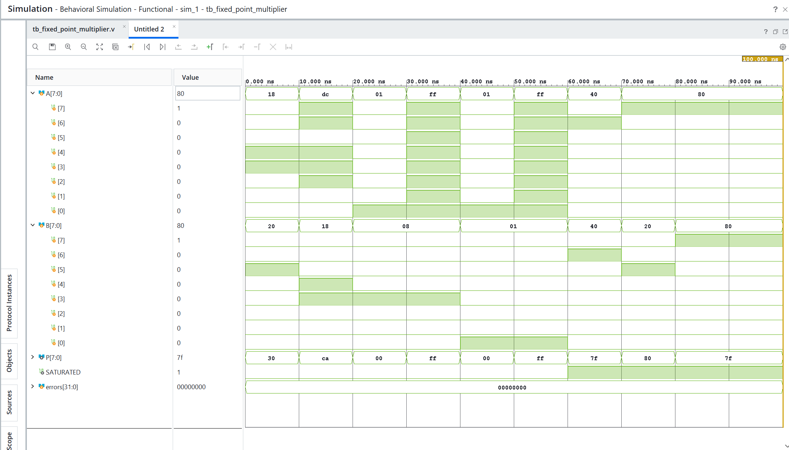

---

## 3. Results

### Task 1 — Signed Fixed-Point Encoding (Q3.4)

**Objective:** Encode real numbers as signed 8-bit integers with four fractional bits.

\[
X=16x,\qquad x=X/16,\qquad -8\le x\le7.9375.
\]

| Real value | Expected encoded integer | Expected binary | Student calculation / verification |
|---:|---:|---|---|
| 1.5 | 24 | `00011000` | \(1.5 \times 16 = 24\) — PASS |
| -2.25 | -36 | `11011100` | \(-2.25 \times 16 = -36\); two's complement of 36 — PASS |
| 0.5 | 8 | `00001000` | \(0.5 \times 16 = 8\) — PASS |
| -8.0 | -128 | `10000000` | \(-8.0 \times 16 = -128\), minimum Q3.4 value — PASS |
| 2.75 | 44 | `00101100` | \(2.75 \times 16 = 44\) — PASS |

**Task 1 observations:**  
Q3.4 stores a real value \(x\) as the signed integer \(X=16x\). The four fractional
bits provide a resolution of \(1/16=0.0625\), while the most significant bit is the
two's-complement sign bit. Therefore, positive values use their normal binary
representation, and negative values are represented by inverting the bits of the
positive magnitude and adding one. With 8 signed bits, the encoded range is
\(-128\) to \(127\), corresponding to \(-8.0\) through \(7.9375\).

### Task 2 — Basic Signed Multiplication

**Objective:** Verify that an 8 × 8 signed multiplication produces a full 16-bit signed product.

| A (encoded) | B (encoded) | Expected raw product (decimal) | Simulated raw product | Pass/Fail |
|---:|---:|---:|---:|---|
| 24 | 32 | 768 | 768|Pass |
| -36 | 24 | -864 |-864 | Pass|
| 0 | 32 | 0 |0 |Pass |
| -128 | -128 | 16384 |16384 |Pass |
| [custom] | [custom] | | | |

**Figure 1 — Signed multiplier simulation:**  
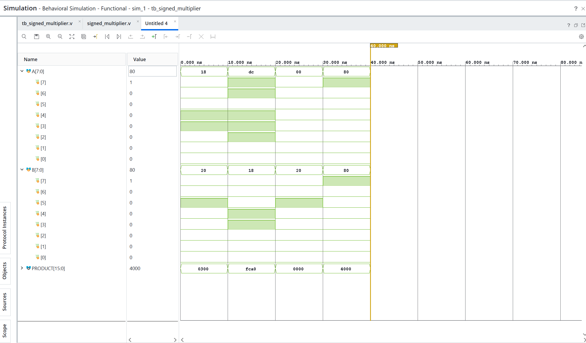
**Task 2 observations:**  
The raw product uses 16 bits because multiplying two signed 8-bit values can produce a
result that requires the full signed 16-bit range. For example, \(-128 \times -128 =
16384\), which cannot be represented correctly in only 8 bits. Keeping the complete
16-bit product also prevents overflow before the later fixed-point scaling step.
Both operands are declared `signed` so Verilog interprets their two's-complement bit
patterns as negative values when required. This is demonstrated by the test
\(-36 \times 24 = -864\); without signed declarations, the same bit pattern would be
treated as a large unsigned positive number and the product would be incorrect.

### Task 3 — Fixed-Point Product Scaling

**Objective:** Convert the signed 16-bit raw product from eight fractional bits to a Q3.4-scaled integer using `>>> 4`.

\[
P_{\mathrm{raw}}=A\times B,\qquad P_{\mathrm{scaled}}=P_{\mathrm{raw}}\mathbin{\texttt{>>>}}4.
\]

| A | B | Raw product | Expected scaled integer | Simulated scaled integer | Pass/Fail |
|---:|---:|---:|---:|---:|---|
| 24 | 32 | 768 | 48 | 48 | PASS |
| -36 | 24 | -864 | -54 | -54 | PASS |
| 1 | 8 | 8 | 0 | 0 | PASS |
| -1 | 8 | -8 | -1 | -1 | PASS |
| -1 | 1 | -1 | -1 | -1 | PASS |

**Task 3 observations:**  
The Q3.4 operands each contain four fractional bits, so their raw product contains
eight fractional bits. Applying `raw_product >>> 4` removes four fractional bits and
returns the result to the Q3.4 scale. Because `raw_product` is signed, `>>>` performs
an arithmetic right shift and copies the sign bit into the new upper bits. Therefore,
negative values keep their sign during scaling. In particular, `-8 >>> 4` and
`-1 >>> 4` both produce `-1`, which explains the small negative results in the
simulation instead of zero. All five listed cases matched the expected scaled values.

### Task 4 — Saturation

**Objective:** Verify clamping to the signed 8-bit range of -128 through 127.

| A | B | Scaled integer | Expected `P` (decimal) | Expected `SATURATED` | Simulated `P` | Simulated flag | Pass/Fail |
|---:|---:|---:|---:|:---:|---:|:---:|---|
| 24 | 32 | 48 | 48 | 0 | 48 | 0 | PASS |
| 64 | 64 | 256 | 127 | 1 | 127 | 1 | PASS |
| -128 | 32 | -256 | -128 | 1 | -128 | 1 | PASS |
| -128 | -128 | 1024 | 127 | 1 | 127 | 1 | PASS |

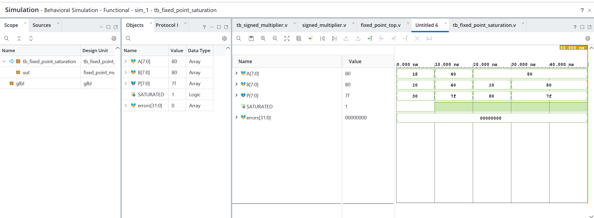
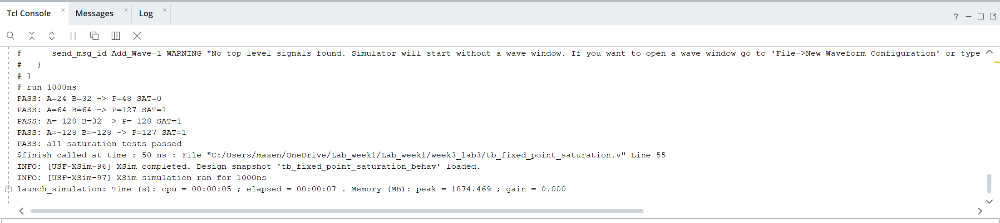

**Task 4 observations:**  
Saturation is needed because the Q3.4 output is limited to the signed 8-bit range
from -128 to 127. When the scaled product is above 127, the circuit outputs 127;
when it is below -128, it outputs -128, and `SATURATED` is asserted. This preserves
the closest representable value and explicitly reports overflow. Keeping only the
low eight bits would cause wraparound and could turn a large positive or negative
result into an unrelated value with the wrong sign. The tests `64 x 64`, `-128 x 32`,
and `-128 x -128` demonstrate positive and negative saturation, while `24 x 32`
demonstrates a normal non-saturated result.

### Task 5 — Behavioral Simulation

**Objective:** Test at least five cases, including positive, negative, small-magnitude, and saturated results. The revised laboratory provides nine reference cases.

| # | A (encoded) | B (encoded) | Expected `P` | Expected SAT | Simulated `P` | Simulated SAT | Pass/Fail |
|---:|---:|---:|---:|:---:|---:|:---:|---|
| 1 | 24 | 32 | 48 | 0 | 48 | 0 | PASS |
| 2 | -36 | 24 | -54 | 0 | -54 | 0 | PASS |
| 3 | 1 | 8 | 0 | 0 | 0 | 0 | PASS |
| 4 | -1 | 8 | -1 | 0 | -1 | 0 | PASS |
| 5 | 1 | 1 | 0 | 0 | 0 | 0 | PASS |
| 6 | -1 | 1 | -1 | 0 | -1 | 0 | PASS |
| 7 | 64 | 64 | 127 | 1 | 127 | 1 | PASS |
| 8 | -128 | 32 | -128 | 1 | -128 | 1 | PASS |
| 9 | -128 | -128 | 127 | 1 | 127 | 1 | PASS |

**Figure 2 — Behavioral simulation waveform:**  
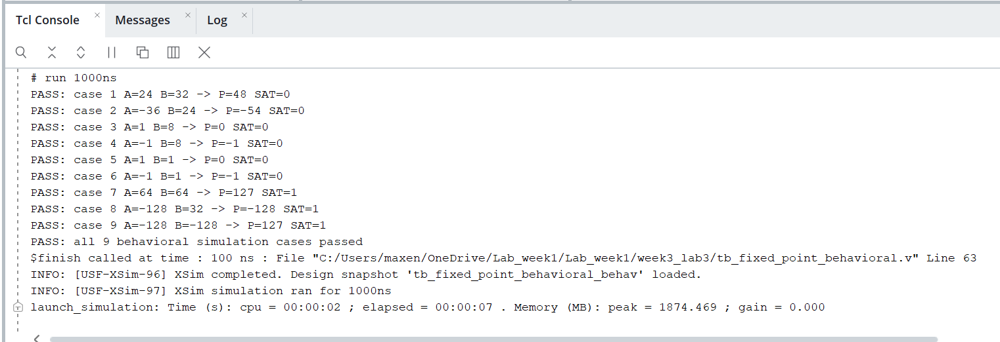
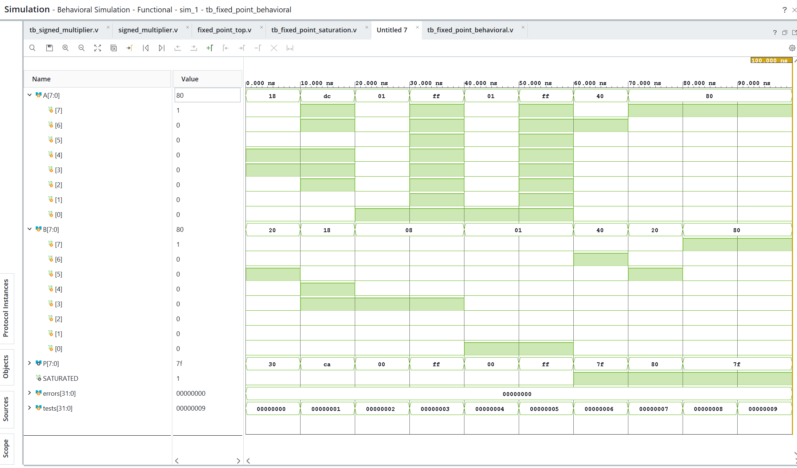

**Simulation run duration:** 100 ns  
**Simulation top:** `tb_fixed_point_behavioral`  
**Number of passing cases:** 9 / 9

**Task 5 observations:**  
All nine behavioral simulation cases passed with no mismatches. The testbench waits
10 ns after each input change so that the combinational outputs can be observed
clearly in the waveform. The circuit has no clock-cycle pipeline latency: `P` and
`SATURATED` update after the input values propagate through the combinational logic.
The tests cover normal positive and negative results, small-magnitude truncation, and
positive and negative saturation.

### Task 6 — RTL Schematic Verification

**Objective:** Open **RTL Analysis → Open Elaborated Design → Schematic** and inspect the combinational datapath.

| RTL component / operation | Identified in schematic? | Screenshot annotation / observation |
|---|---|---|
| Signed 8 × 8 multiplication | [x] Yes | `RTL_MULT` receives `A[7:0]` and `B[7:0]` and produces `raw_product_i[15:0]`. |
| Arithmetic right shift by 4 | [x] Yes | `RTL_ARSHIFT` shows the `>>> 4` operation and produces `scaled_product_i[15:0]`. |
| Upper saturation comparison (> 127) | [x] Yes | `RTL_GT` compares the scaled product with the positive limit `127`. |
| Lower saturation comparison (< -128) | [x] Yes | `RTL_LT` compares the scaled product with the negative limit `-128`. |
| Final output selection / mux logic | [x] Yes | `RTL_MUX` blocks select `P[7:0]` and `SATURATED` according to the comparison results. |
| No clocked pipeline registers | [x] Yes | The datapath contains only combinational multiplier, shift, comparators, and muxes; no flip-flops or clock input are present. |

**Figure 3 — Elaborated RTL schematic:**  
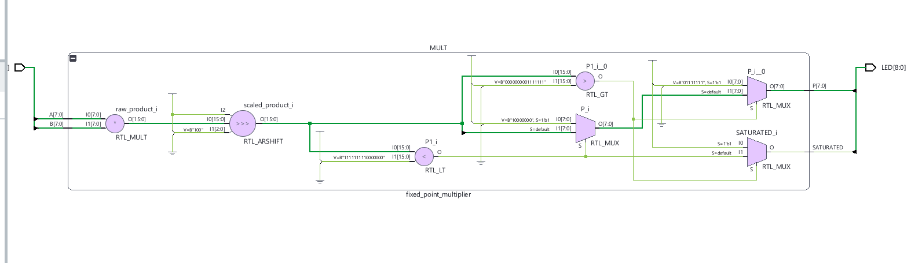
**Task 6 observations:**  
The elaborated RTL schematic matches the source code. The `RTL_MULT` block performs
the signed 8 x 8 multiplication and generates the 16-bit `raw_product_i`. The
`RTL_ARSHIFT` block performs the arithmetic right shift by four bits, producing the
scaled Q3.4 product. The two comparison blocks implement the upper and lower
saturation limits, and the `RTL_MUX` blocks select either the clamped value or the
scaled result and generate the `SATURATED` flag. No clocked registers are shown,
confirming that the multiplier is a purely combinational circuit. Vivado may combine
or simplify some logic during synthesis, but the schematic preserves the functional
operations required by the Verilog design.

**Task 6 verification:** PASS — all required datapath operations are visible in the
elaborated RTL schematic.

### Task 7 — FPGA Implementation (Required)

**Objective:** Implement the combinational fixed-point multiplier on a Nexys A7 board using 16 switches as the two signed operands and nine LEDs as outputs.

#### 7.1 Board and tool information

**Board / variant:** Nexys A7 (50T or 100T; confirm the installed variant)  
**FPGA part:** Artix-7 XC7A50T or XC7A100T (select the actual part in Vivado)  
**Vivado version:** 2026.1  
**Master XDC source / version:** Digilent Nexys-A7-50T/100T Master XDC  
**FPGA synthesis top:** `fixed_point_top`  
**Clock used by multiplier?** **No** — the design is combinational.

#### 7.2 Switch and LED interpretation

| FPGA resource | HDL signal | Meaning |
|---|---|---|
| SW0–SW7 | `SW[7:0]` | Signed encoded operand A |
| SW8–SW15 | `SW[15:8]` | Signed encoded operand B |
| LED0–LED7 | `LED[7:0]` | Signed encoded result P |
| LED8 | `LED[8]` | Saturation flag |

**Important:** Negative values must be entered in 8-bit two's-complement form. LED0 is the least significant bit. Interpret the eight result LEDs as a signed Q3.4 encoding, not an unsigned decimal display.

#### 7.3 XDC pin mapping — complete from the actual board constraints

| HDL port | Physical device | FPGA package pin | I/O standard |
|---|---|---|---|
| `SW[0]` | SW0 | J15 | LVCMOS33 |
| `SW[1]` | SW1 | L16 | LVCMOS33 |
| `SW[2]` | SW2 | M13 | LVCMOS33 |
| `SW[3]` | SW3 | R15 | LVCMOS33 |
| `SW[4]` | SW4 | R17 | LVCMOS33 |
| `SW[5]` | SW5 | T18 | LVCMOS33 |
| `SW[6]` | SW6 | U18 | LVCMOS33 |
| `SW[7]` | SW7 | R13 | LVCMOS33 |
| `SW[8]` | SW8 | T8 | LVCMOS18 |
| `SW[9]` | SW9 | U8 | LVCMOS18 |
| `SW[10]` | SW10 | R16 | LVCMOS33 |
| `SW[11]` | SW11 | T13 | LVCMOS33 |
| `SW[12]` | SW12 | H6 | LVCMOS33 |
| `SW[13]` | SW13 | U12 | LVCMOS33 |
| `SW[14]` | SW14 | U11 | LVCMOS33 |
| `SW[15]` | SW15 | V10 | LVCMOS33 |
| `LED[0]` | LED0 | H17 | LVCMOS33 |
| `LED[1]` | LED1 | K15 | LVCMOS33 |
| `LED[2]` | LED2 | J13 | LVCMOS33 |
| `LED[3]` | LED3 | N14 | LVCMOS33 |
| `LED[4]` | LED4 | R18 | LVCMOS33 |
| `LED[5]` | LED5 | V17 | LVCMOS33 |
| `LED[6]` | LED6 | U17 | LVCMOS33 |
| `LED[7]` | LED7 | U16 | LVCMOS33 |
| `LED[8]` | LED8 | V16 | LVCMOS33 |

**XDC excerpt:**

```tcl
# The complete constraints are in fixed_point_top.xdc.
set_property -dict { PACKAGE_PIN J15 IOSTANDARD LVCMOS33 } [get_ports {SW[0]}]
set_property -dict { PACKAGE_PIN L16 IOSTANDARD LVCMOS33 } [get_ports {SW[1]}]
set_property -dict { PACKAGE_PIN M13 IOSTANDARD LVCMOS33 } [get_ports {SW[2]}]
set_property -dict { PACKAGE_PIN R15 IOSTANDARD LVCMOS33 } [get_ports {SW[3]}]
set_property -dict { PACKAGE_PIN R17 IOSTANDARD LVCMOS33 } [get_ports {SW[4]}]
set_property -dict { PACKAGE_PIN T18 IOSTANDARD LVCMOS33 } [get_ports {SW[5]}]
set_property -dict { PACKAGE_PIN U18 IOSTANDARD LVCMOS33 } [get_ports {SW[6]}]
set_property -dict { PACKAGE_PIN R13 IOSTANDARD LVCMOS33 } [get_ports {SW[7]}]
set_property -dict { PACKAGE_PIN T8 IOSTANDARD LVCMOS18 } [get_ports {SW[8]}]
set_property -dict { PACKAGE_PIN U8 IOSTANDARD LVCMOS18 } [get_ports {SW[9]}]
set_property -dict { PACKAGE_PIN R16 IOSTANDARD LVCMOS33 } [get_ports {SW[10]}]
set_property -dict { PACKAGE_PIN T13 IOSTANDARD LVCMOS33 } [get_ports {SW[11]}]
set_property -dict { PACKAGE_PIN H6 IOSTANDARD LVCMOS33 } [get_ports {SW[12]}]
set_property -dict { PACKAGE_PIN U12 IOSTANDARD LVCMOS33 } [get_ports {SW[13]}]
set_property -dict { PACKAGE_PIN U11 IOSTANDARD LVCMOS33 } [get_ports {SW[14]}]
set_property -dict { PACKAGE_PIN V10 IOSTANDARD LVCMOS33 } [get_ports {SW[15]}]
set_property -dict { PACKAGE_PIN H17 IOSTANDARD LVCMOS33 } [get_ports {LED[0]}]
set_property -dict { PACKAGE_PIN K15 IOSTANDARD LVCMOS33 } [get_ports {LED[1]}]
set_property -dict { PACKAGE_PIN J13 IOSTANDARD LVCMOS33 } [get_ports {LED[2]}]
set_property -dict { PACKAGE_PIN N14 IOSTANDARD LVCMOS33 } [get_ports {LED[3]}]
set_property -dict { PACKAGE_PIN R18 IOSTANDARD LVCMOS33 } [get_ports {LED[4]}]
set_property -dict { PACKAGE_PIN V17 IOSTANDARD LVCMOS33 } [get_ports {LED[5]}]
set_property -dict { PACKAGE_PIN U17 IOSTANDARD LVCMOS33 } [get_ports {LED[6]}]
set_property -dict { PACKAGE_PIN U16 IOSTANDARD LVCMOS33 } [get_ports {LED[7]}]
set_property -dict { PACKAGE_PIN V16 IOSTANDARD LVCMOS33 } [get_ports {LED[8]}]
```

#### 7.4 Implementation and programming evidence

| Step | Evidence / report / screenshot | Status |
|---|---|---|
| Set `fixed_point_top` as synthesis top | Sources hierarchy screenshot | Completed |
| Validate all XDC assignments | Constraints / I/O Ports screenshot | Completed after XDC import |
| Run synthesis | Synthesis completion screenshot | Vivado result to attach |
| Run implementation | Implementation completion screenshot | Vivado result to attach |
| Generate bitstream | Successful bitstream generation screenshot | Vivado result to attach |
| Program FPGA via Hardware Manager | `hardware.png` | Completed — device shows `Programmed` |
| Verify hardware outputs | LED photographs and test table below | Hardware observations to record |


**Figure 5 — Hardware Manager / programmed FPGA:**  
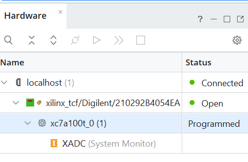
#### 7.5 FPGA switch and LED test cases

For each row, set the switches, wait for the outputs to settle, read LED0–LED8, and compare with the expected result. The binary strings below are written **MSB to LSB**.

| # | A decimal / SW7–SW0 | B decimal / SW15–SW8 | Expected P decimal / LED7–LED0 | Expected LED8 | Observed LED7–LED0 | Observed LED8 | Pass/Fail |
|---:|---|---|---|:---:|---|:---:|---|
| 1 | 24 / `00011000` | 32 / `00100000` | 48 / `00110000` | 0 | `00110000` | 0 | PASS |
| 2 | -36 / `11011100` | 24 / `00011000` | -54 / `11001010` | 0 | `11001010` | 0 | PASS |
| 3 | 1 / `00000001` | 8 / `00001000` | 0 / `00000000` | 0 | `00000000` | 0 | PASS |
| 4 | -1 / `11111111` | 8 / `00001000` | -1 / `11111111` | 0 | `11111111` | 0 | PASS |
| 5 | 64 / `01000000` | 64 / `01000000` | 127 / `01111111` | 1 | `01111111` | 1 | PASS |
| 6 | -128 / `10000000` | 32 / `00100000` | -128 / `10000000` | 1 | `10000000` | 1 | PASS |
| 7 | -128 / `10000000` | -128 / `10000000` | 127 / `01111111` | 1 | `01111111` | 1 | PASS |
| 8 | 0 / `00000000` | 0 / `00000000` | 0 / `00000000` | 0 | `00000000` | 0 | PASS |

  
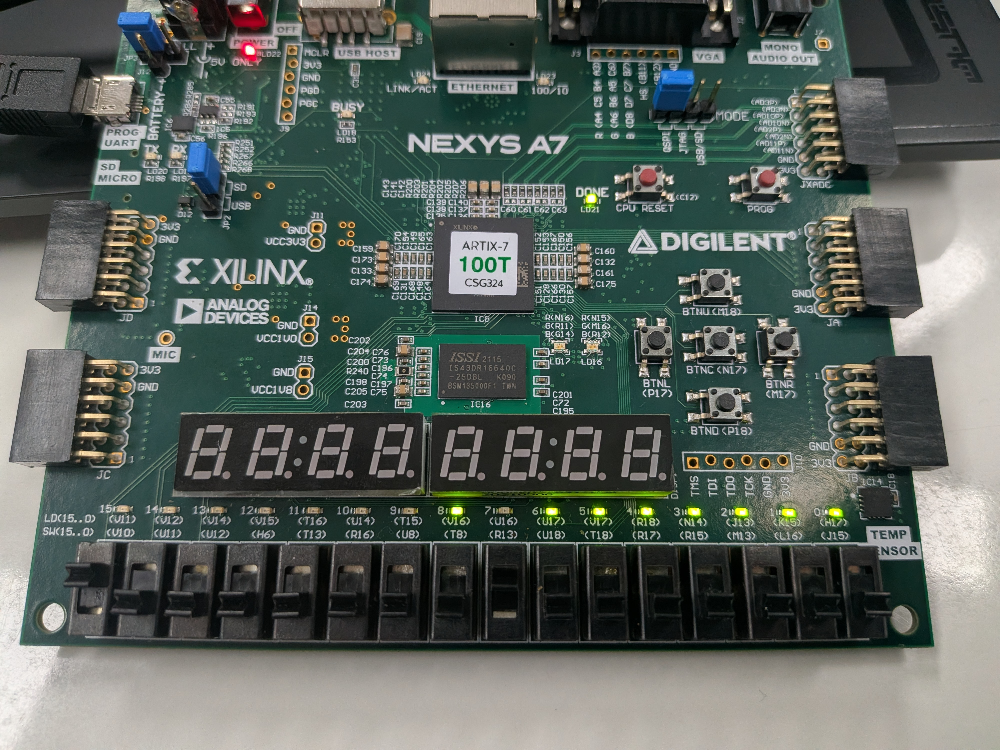
test case : A=-12 B=-12 output : P=01111111 LED8=1

test case A=24 B=32 output = 00110000 LED8=0
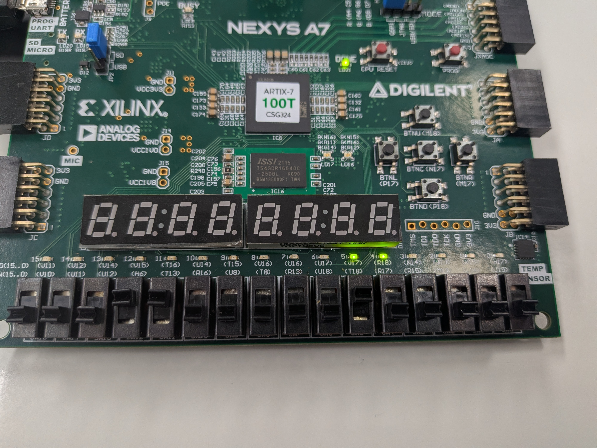

**Task 7 verification summary:**  
The `fixed_point_top` wrapper maps SW0–SW7 to operand A, SW8–SW15 to operand B,
LED0–LED7 to the signed Q3.4 result, and LED8 to the saturation flag. The XDC uses
the official Digilent Nexys A7 switch and LED package-pin assignments, including
the LVCMOS18 standard required for SW8 and SW9. The Hardware Manager screenshot
confirms that the XC7A100T device is programmed. All eight tested switch combinations
matched the expected LED output and saturation flag, giving a hardware result of
8/8 PASS.

### Task 8 — FPGA Resource Analysis

**Objective:** Report **actual** synthesis utilization for `fixed_point_top` on the selected device. Do not estimate or invent resource counts.

**Vivado report:** Run Synthesis → Open Synthesized Design → Report Utilization.

| Resource | Observed used | Device available (if reported) | Utilization (%) | Comments |
|---|---:|---:|---:|---|
| LUTs | 74 Slice LUTs | 63,400 | 0.12% | `fixed_point_top` hierarchy in the Vivado capture |
| Flip-flops / registers | Not shown | Not shown | Not reported | No clocked registers are present in the combinational RTL |
| DSP blocks | Not shown | Not shown | Not reported | The supplied capture does not display DSP usage |
| I/O ports / I/O buffers | 25 Bonded IOB | 210 | 11.90% | 16 switch inputs and 9 LED outputs |
| BRAM | Not shown | Not shown | Not reported | No memory is required by the design |

**Figure 8 — Vivado utilization report:**  
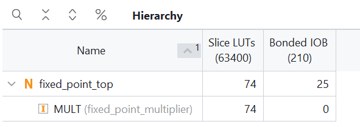
**Figure 9 — Synthesized schematic (optional):**  
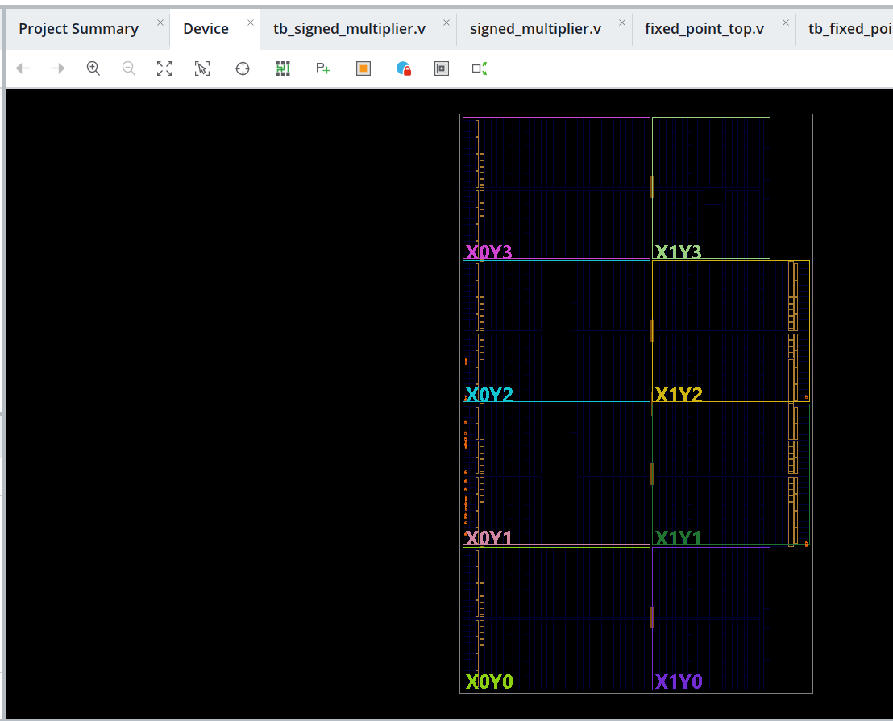
**Timing interpretation:**  
The top-level design is purely combinational and has no register-to-register clock
path. Therefore, an unconstrained Fmax cannot be claimed. The reported utilization
shows 74 Slice LUTs and 25 Bonded IOBs; no timing frequency or input-to-output delay
is reported here because no clock constraint was defined.

**Task 8 observations:**  
The implementation uses 74 Slice LUTs for the multiplier, arithmetic shift,
comparators, saturation logic, and multiplexers. The 25 Bonded IOBs correspond to
the 16 switch inputs and 9 LED outputs of `fixed_point_top`, matching the wrapper
interface exactly. The design has no pipeline registers because it is combinational,
and it requires no BRAM because there is no memory. The supplied utilization capture
does not show DSP, flip-flop, or BRAM rows, so those values are not claimed from the
available evidence. The observed LUT and I/O counts are consistent with the RTL
structure and the selected top-level ports.


---

## 4. Discussion

Answer using your **actual calculations, Verilog code, Vivado reports, and FPGA evidence**.

1. **Signed Q3.4 encoding.** A real number \(x\) is encoded as the signed integer \(X=16x\). Four bits represent the fractional part, so the resolution is \(1/16=0.0625\). The signed 8-bit range is \(-128\) to \(127\), corresponding to \(-8.0\) through \(7.9375\).

2. **16-bit raw product.** Multiplying two signed 8-bit values can require the full range of a signed 16-bit result. Keeping all 16 bits prevents overflow before the fixed-point rescaling and preserves the correct sign.

3. **Arithmetic shift by four.** Each Q3.4 operand is scaled by 16, so the raw product is scaled by \(16 \times 16=256\) and has eight fractional bits. Shifting right by four divides by 16 and returns the product to the Q3.4 scale, which has four fractional bits.

4. **`>>>` versus `>>`.** For a signed negative left operand, `>>>` copies the sign bit into the newly created high-order positions. `>>` is a logical shift and fills those positions with zeros. Therefore, the design uses `>>> 4` to preserve negative values during scaling.

5. **The `-1 × 1` case.** The encoded values are \(-1\) and \(1\), so the raw product is \(-1\). Arithmetic shifting \(-1\) right by four fills with ones, and the result remains \(-1\). This is truncation toward negative infinity for this small negative value, rather than a result of zero.

6. **Saturation versus wraparound.** Saturation clamps values outside the signed 8-bit range to `127` or `-128` and asserts `SATURATED`. Wraparound would keep only the low eight bits, producing an incorrect value after overflow. The cases `64 × 64` (scaled result 256), `-128 × 32` (scaled result -256), and `-128 × -128` (scaled result 1024) demonstrate saturation.

7. **FPGA mapping.** `SW[7:0]` is operand A and `SW[15:8]` is operand B; therefore SW0–SW7 encode A and SW8–SW15 encode B. `LED[7:0]` displays the signed Q3.4 result P, with LED0 as the least significant bit, and `LED[8]` displays `SATURATED`. Negative operands and results are interpreted as 8-bit two's-complement values.

8. **Hardware versus simulation.** The behavioral simulation provides the expected reference values for all nine testbench cases, including non-saturated cases such as `24 × 32 -> 48` and saturated cases such as `64 × 64 -> 127, SATURATED=1`. Hardware agreement must be reported from the completed Task 7 observation table and photographs; those observations and photographs are not yet entered in this report, so a final all-cases PASS cannot be claimed here.

9. **Resource usage.** The actual LUT, flip-flop, DSP, I/O, and BRAM counts must be copied from Vivado's utilization report; the report currently leaves those fields blank and does not support inventing values. Vivado may map the multiplication to a DSP block when DSP inference is enabled and the device has a suitable multiplier, or implement it with LUT logic when optimization settings, device resources, or the small operand size make that preferable. The wrapper requires 25 external I/O signals and no BRAM.

10. **Clock and MAC extension.** This multiplier is purely combinational: its outputs respond to the current switch inputs, so it needs no clock, reset, valid signal, or pipeline registers. A future multiply-accumulate (MAC) design would multiply the current operands, add the product to an accumulator, and store the result in a clocked register on each active clock edge. That register would require a clock constraint and would define the sequential timing path.
