# Laboratory Report Template
## 977-220 Electronics and IoT — Week 3, Slot 12
### Vivado-8: Multiply–Accumulate (MAC) Design

**Reference:** https://github.com/komsan-k/977-220/tree/main/fpga-2026/week-3/slot-12

> **Report instructions:** Replace bracketed prompts with your own work. Include original HDL and testbench code, XSim waveform captures, and verification evidence. Report actual measurements rather than assuming a PASS result.

**Student name:** Maxence Dabrowski
**Student ID:** 6900103749
**Date:** 13/11/2026

---

## 1. Achievement

After completing this laboratory, I can:

- Implement a sequential **multiply–accumulate (MAC)** circuit, `ACC <= ACC + A * B`.
- Explain the function of the accumulator register and the active clock edge.
- Implement and verify **reset** and **enable** controls.
- Write a testbench to apply three input pairs and verify the accumulated result of **32**.
- Construct a hierarchical MAC from separate **multiplier**, **adder**, and **accumulator** modules.
- Compare behavioral simulation and structural hierarchy, and interpret waveforms in Vivado XSim.

**Achievement summary:**

[Write 60–100 words describing your completed designs, successful tests, challenges, and skills gained.]

---

## 2. Verilog/SystemVerilog 


**Submitted project contents:**

- [ ] Sequential MAC RTL source
- [ ] Reset/enable MAC source
- [ ] Functional testbench(s)
- [ ] Hierarchical multiplier, adder, and accumulator source modules
- [ ] Hierarchical top-level MAC module
- [ ] Simulation waveforms and console outputs
- [ ] Vivado hierarchy / elaborated RTL schematic screenshots

---

## 3. Results

### Task 2 — Sequential MAC

**Objective:** Implement a clocked accumulator:

$$
ACC_{n+1}=ACC_n+A_n\times B_n.
$$

**Design configuration:**

| Parameter | Value |
|---|---|
| Width of `A` | 8 bits |
| Width of `B` | 8 bits |
| Width of `ACC` | 24 bits |
| Signed or unsigned arithmetic | Unsigned |
| Clock / active edge | Rising edge (`posedge clk`) |
| Overflow handling (wrap, widen, saturate, etc.) | 24-bit wraparound; no saturation |

**3.1 Architecture diagram:**

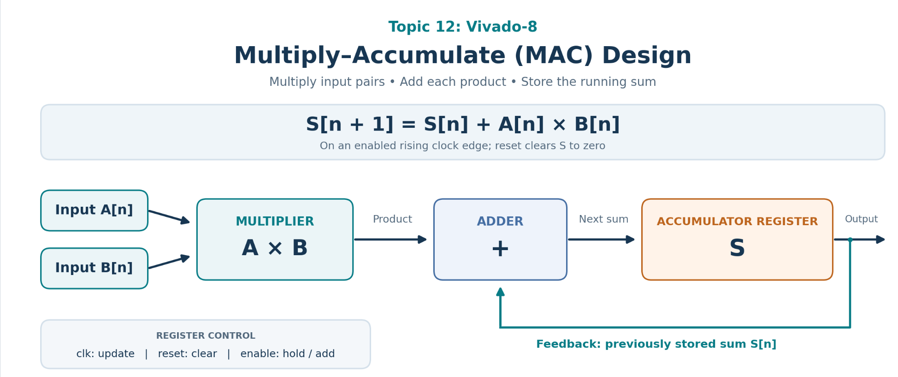
**Figure 1.** Sequential MAC datapath.

**3.2 RTL implementation:**

```systemverilog
// Paste your sequential MAC module here.
module mult8(
    input  wire [7:0] A,
    input  wire [7:0] B,
    output wire [15:0] P
);

    assign P = A * B;

endmodule

module add24(
    input  wire [23:0] A,
    input  wire [23:0] B,
    output wire [23:0] SUM
);

    assign SUM = A + B;

endmodule

module accumulator24(
    input  wire        clk,
    input  wire        reset,
    input  wire        enable,
    input  wire [23:0] D,
    output reg  [23:0] Q
);

    always @(posedge clk) begin

        if (reset)
            Q <= 24'd0;

        else if (enable)
            Q <= D;

    end

endmodule

module mac_hierarchical(
    input  wire        clk,
    input  wire        reset,
    input  wire        enable,
    input  wire [7:0]  A,
    input  wire [7:0]  B,
    output wire [23:0] ACC
);

    wire [15:0] product;
    wire [23:0] product_ext;
    wire [23:0] sum_next;

    assign product_ext = {8'd0, product};

    mult8 MULT (
        .A(A),
        .B(B),
        .P(product)
    );

    add24 ADD (
        .A(ACC),
        .B(product_ext),
        .SUM(sum_next)
    );

    accumulator24 ACCUM (
        .clk(clk),
        .reset(reset),
        .enable(enable),
        .D(sum_next),
        .Q(ACC)
    );

endmodule
```

**3.3 Basic functional verification:**

| Clock event | A | B | A × B | Expected ACC | Simulated ACC | Pass/Fail |
|---|---:|---:|---:|---:|---:|---|
| Reset / initial state | — | — | — | 0 | 0| Pass|
| First enabled update | 2 | 3 | 6 | 6 |6 |Pass |
| Second enabled update | 4 | 5 | 20 | 26 | 26| Pass|
| Third enabled update | 1 | 6 | 6 | 32 | 32| Pass|

**3.4 Waveform:**

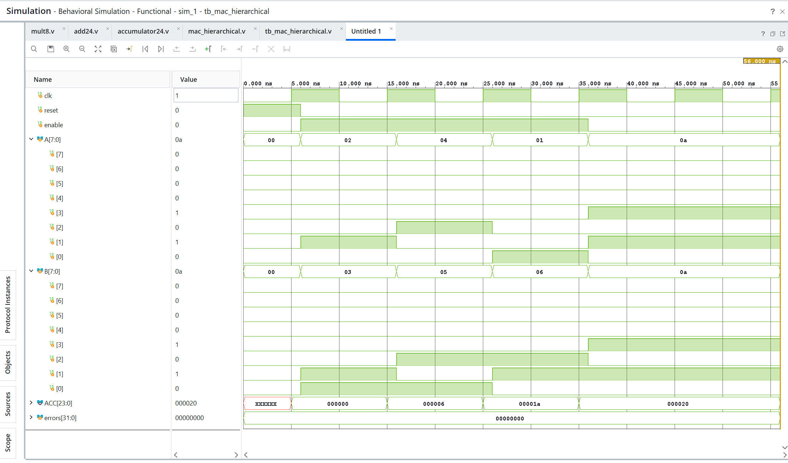
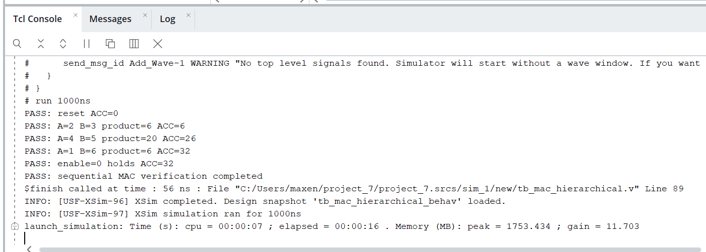
**Figure 2.** Sequential MAC waveform.

**Task 2 verification summary:** All test passed without any errors.

### Task 3 — Reset and Enable

**Objective:** Add `reset` and `enable` so that the accumulator resets to zero and updates only when enabled.

**Expected behavior** (assuming a synchronous, active-high reset; change this description if your design differs):

$$
ACC_{n+1}=\begin{cases}
0,&reset=1,\\
ACC_n+A_nB_n,&reset=0\text{ and }enable=1,\\
ACC_n,&reset=0\text{ and }enable=0.
\end{cases}
$$

**3.5 Reset/enable RTL:**

```systemverilog
// Paste your modified MAC module here.
module mac_reset_enable(
    input wire        clk,
    input wire        reset,
    input wire        enable,
    input wire [7:0]  A,
    input wire [7:0]  B,
    output reg [23:0] ACC
);

    wire [15:0] product;

    assign product = A * B;

    always @(posedge clk) begin
        if (reset)
            ACC <= 24'd0;
        else if (enable)
            ACC <= ACC + product;
    end

endmodule
```

**3.6 Control verification:**

| Test | Reset | Enable | Applied A, B | Expected behavior | Expected ACC | Simulated ACC | Pass/Fail |
|---|:---:|:---:|---|---|---:|---:|---|
| Reset | 1 | X | [ ] | Clear accumulator | 0 |0 |Pass |
| Accumulate | 0 | 1 | 2, 3 | Add 6 | 6 |6 | Pass|
| Hold | 0 | 0 | 4, 5 | Keep prior value | 6 | 6| Pass|
| Resume | 0 | 1 | 4, 5 | Add 20 | 26 |26 | Pass|
| Reset again | 1 | X | [ ] | Clear accumulator | 0 |0 |Pass |

**3.7 Reset/enable waveform:**

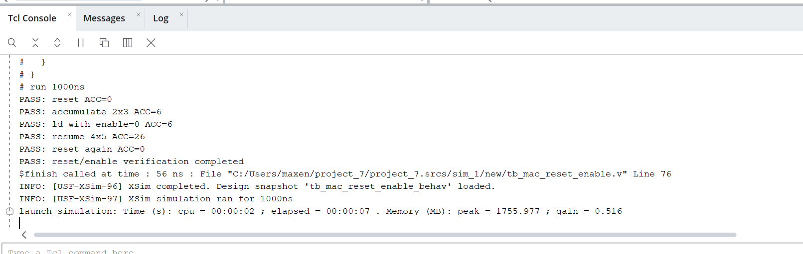
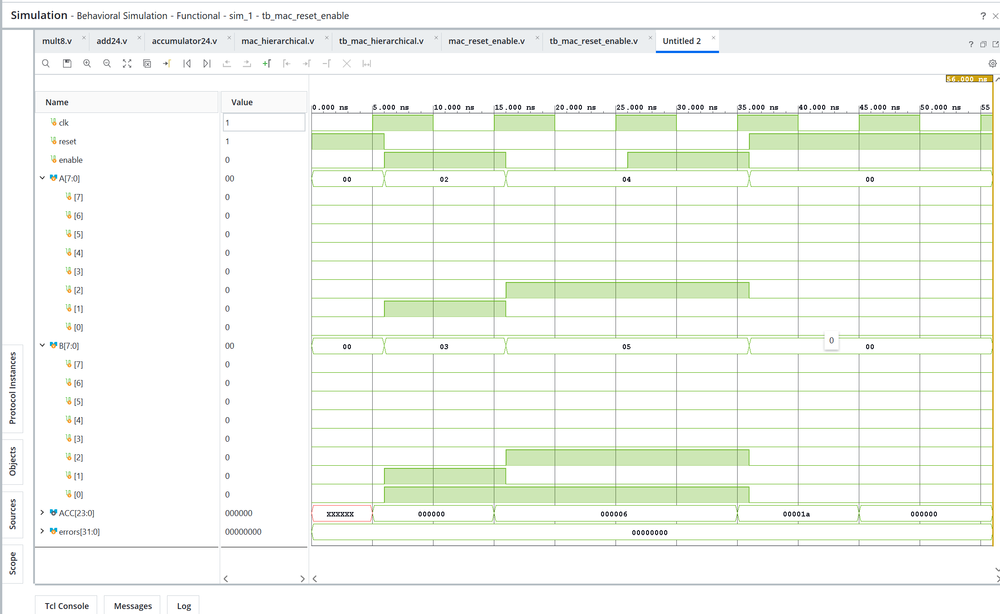
**Figure 3.** Reset and enable verification.

**Task 3 verification summary:**  
The accumulator changed only on the rising edge of `clk`. When `reset=1`, the
synchronous reset cleared `ACC` to zero at the next rising edge. With
`reset=0` and `enable=1`, the product was added at the next rising edge:
`2 x 3` changed `ACC` from 0 to 6, and `4 x 5` changed it from 6 to 26.
When `enable=0`, the accumulator held its previous value of 6 even though the
inputs were set to `4` and `5`. After enable was asserted again, the pending
product was accumulated and `ACC` became 26. A second reset returned the
accumulator to zero. No unexpected changes occurred between clock edges.

### Task 4 — Testbench and ACC = 32

**Objective:** Verify the sequence `(2,3)`, `(4,5)`, `(1,6)` and confirm `ACC = 32` after exactly three enabled accumulation edges from an initial zero value.

**Manual calculation:**

$$
ACC_0=0,
\quad ACC_1=0+(2\times3)=6,
\quad ACC_2=6+(4\times5)=26,
\quad ACC_3=26+(1\times6)=32.
$$

**3.8 Testbench implementation:**

```systemverilog
`timescale 1ns / 1ps

module tb_mac_acc32;

    reg        clk;
    reg        reset;
    reg        enable;
    reg  [7:0] A;
    reg  [7:0] B;
    wire [23:0] ACC;
    integer errors;

    mac_reset_enable uut (
        .clk(clk),
        .reset(reset),
        .enable(enable),
        .A(A),
        .B(B),
        .ACC(ACC)
    );

    always #5 clk = ~clk;

    task apply_and_check;
        input [7:0] test_a;
        input [7:0] test_b;
        input [23:0] expected_acc;
        begin
            @(negedge clk);
            A = test_a;
            B = test_b;
            @(posedge clk);
            #1;

            if (ACC !== expected_acc) begin
                errors = errors + 1;
                $display("FAIL: A=%0d B=%0d expected ACC=%0d got ACC=%0d",
                         A, B, expected_acc, ACC);
            end
            else begin
                $display("PASS: A=%0d B=%0d product=%0d ACC=%0d",
                         A, B, A * B, ACC);
            end
        end
    endtask

    initial begin
        clk = 1'b0;
        reset = 1'b1;
        enable = 1'b0;
        A = 8'd0;
        B = 8'd0;
        errors = 0;

        @(posedge clk);
        #1;
        if (ACC !== 24'd0) begin
            errors = errors + 1;
            $display("FAIL: reset expected ACC=0 got ACC=%0d", ACC);
        end

        @(negedge clk);
        reset = 1'b0;
        enable = 1'b1;

        apply_and_check(8'd2, 8'd3, 24'd6);
        apply_and_check(8'd4, 8'd5, 24'd26);
        apply_and_check(8'd1, 8'd6, 24'd32);

        if (errors != 0)
            $fatal(1, "FAIL: %0d test(s) failed", errors);

        $display("PASS: ACC reached 32 after three enabled updates");
        #10;
        $finish;
    end

endmodule
```

**3.9 Simulation results:**

| Cycle | Inputs (A, B) | Expected product | Expected ACC | Observed ACC | Status |
|---:|---|---:|---:|---:|---|
| 0 | Reset | — | 0 | 0|Pass |
| 1 | (2, 3) | 6 | 6 |6 | Pass|
| 2 | (4, 5) | 20 | 26 |26 |Pass |
| 3 | (1, 6) | 6 | 32 | 32|Pass |

**3.10 Console / self-check evidence:**

```text
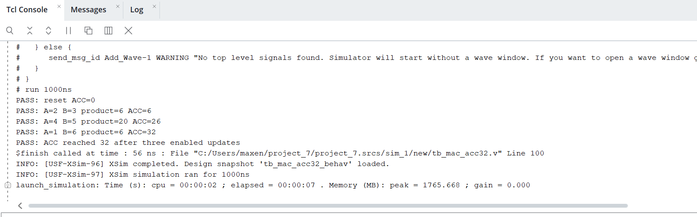
```

**3.11 XSim waveform:**

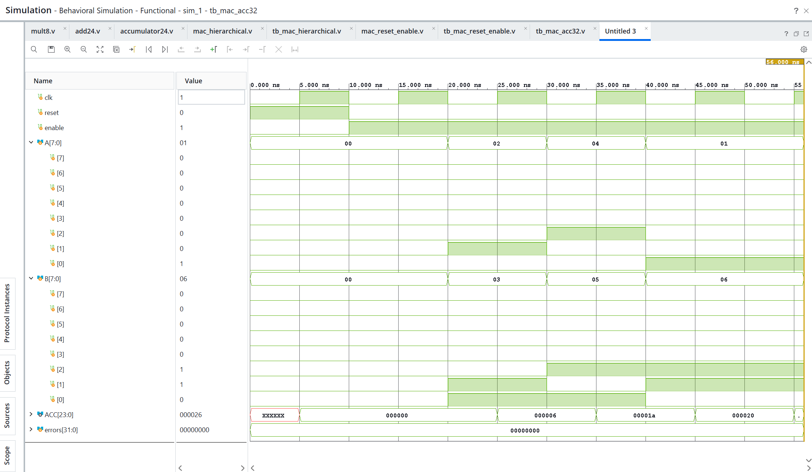
**Figure 4.** Three-pair MAC test sequence.

**Task 4 verification summary:**  
All checked values matched the expected accumulation sequence. Starting from the
reset value `ACC=0`, the testbench verified `ACC=6` after `(2,3)`, `ACC=26` after
`(4,5)`, and `ACC=32` after `(1,6)`. The testbench checked each result
automatically after the corresponding rising clock edge and incremented an error
counter whenever a mismatch occurred. It finished with the message
`PASS: ACC reached 32 after three enabled updates`, confirming three successful
enabled accumulation cycles and no detected errors.

### Task 7 — Hierarchical MAC

**Objective:** Reimplement the MAC using separate **multiplier**, **adder**, and **accumulator** modules.

**3.12 Module breakdown:**

| Module | Function | Inputs | Outputs |
|---|---|---|---|
| Multiplier | Compute `A × B` | `A[7:0]`, `B[7:0]` | `P[15:0]` |
| Adder | Compute `ACC + product` | `A[23:0]`, `B[23:0]` | `SUM[23:0]` |
| Accumulator register | Store new ACC on enabled clock edge | `clk`, `reset`, `enable`, `D[23:0]` | `Q[23:0]` |
| MAC top | Connect module instances | `clk`, `reset`, `enable`, `A[7:0]`, `B[7:0]` | `ACC[23:0]` |

**3.13 Module implementations:**

```systemverilog
module mult8(
    input wire [7:0] A, B,
    output wire [15:0] P
);
    assign P = A * B;
endmodule

module add24(
    input wire [23:0] A, B,
    output wire [23:0] SUM
);
    assign SUM = A + B;
endmodule

module accumulator24(
    input wire clk, reset, enable,
    input wire [23:0] D,
    output reg [23:0] Q
);
    always @(posedge clk) begin
        if (reset)
            Q <= 24'd0;
        else if (enable)
            Q <= D;
    end
endmodule
```

**3.14 Hierarchical MAC top module:**

```systemverilog
module mac_hierarchical(
    input wire clk, reset, enable,
    input wire [7:0] A, B,
    output wire [23:0] ACC
);
    wire [15:0] product;
    wire [23:0] product_ext;
    wire [23:0] sum_next;

    assign product_ext = {8'd0, product};
    mult8 MULT(.A(A), .B(B), .P(product));
    add24 ADD(.A(ACC), .B(product_ext), .SUM(sum_next));
    accumulator24 ACCUM(
        .clk(clk), .reset(reset), .enable(enable),
        .D(sum_next), .Q(ACC)
    );
endmodule
```

**3.15 Vivado design hierarchy:**

The expected hierarchy is `mac_hierarchical` containing the instances `MULT`,
`ADD`, and `ACCUM`. Add the Vivado Sources → Hierarchy screenshot after
elaboration.
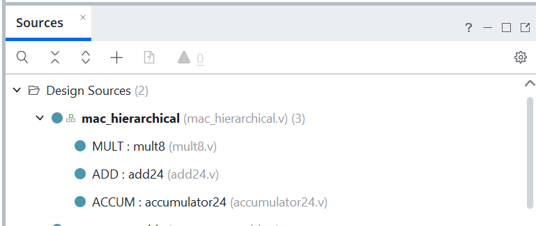
**Figure 5.** MAC module hierarchy.

**3.16 Elaborated schematic:**
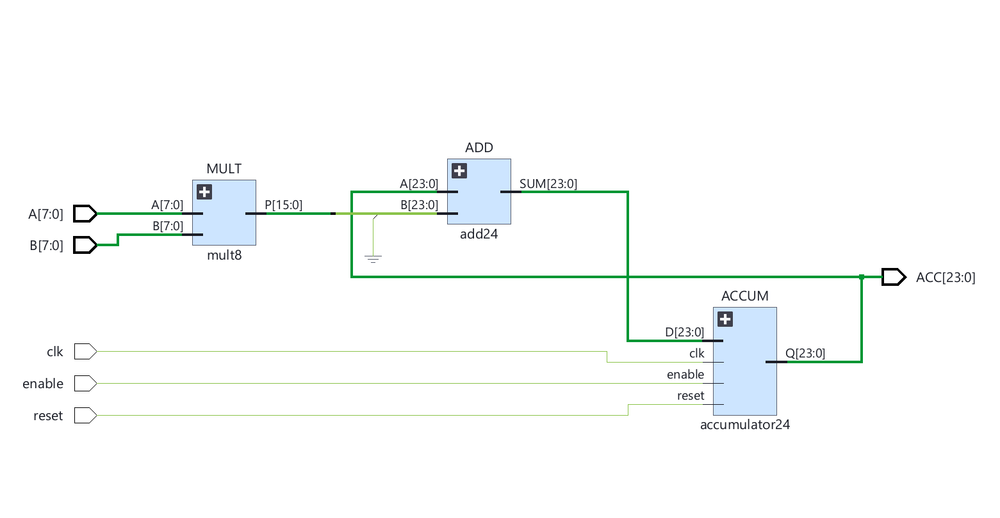
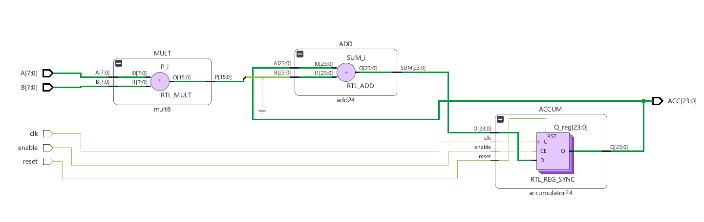
The expected schematic contains the multiplier, zero extension, adder feedback
from `ACC`, and the clocked accumulator register. Add the Vivado Open Elaborated
Design screenshot after elaboration.

**Figure 6.** Hierarchical MAC RTL schematic.

**3.17 Behavioral vs. hierarchical verification:**

| Input sequence or control case | Expected ACC | Behavioral ACC | Hierarchical ACC | Match? |
|---|---:|---:|---:|---|
| Reset | 0 | 0 | 0 | PASS |
| (2,3) | 6 | 6 | 6 | PASS |
| (4,5) | 26 | 26 | 26 | PASS |
| (1,6) | 32 | 32 | 32 | PASS |
| Enable = 0 after reaching 32 | 32 | 32 | 32 | PASS |

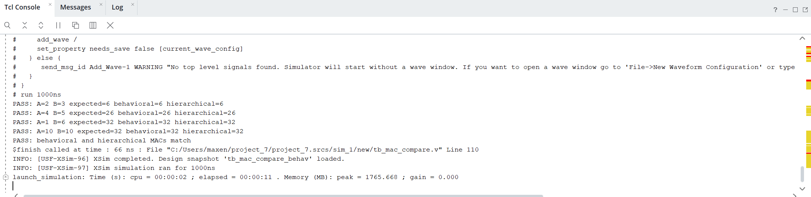

**Task 7 verification summary:**  
The behavioral and hierarchical MACs implement the same reset, enable, and
accumulation behavior. Both versions produce the sequence `0 -> 6 -> 26 -> 32`
for `(2,3)`, `(4,5)`, and `(1,6)`, and both hold `ACC=32` when `enable=0`.
The comparison testbench checks both outputs against the expected value after
each rising clock edge and reports a mismatch if the two implementations differ.
The behavioral version expresses the multiply and accumulation directly, whereas
the hierarchical version exposes separate `mult8`, `add24`, and `accumulator24`
instances in the Vivado hierarchy.

---

## 4. Discussion

Answer each question using observations from **your own** RTL and simulations.

1. **Sequential versus combinational operation.** A combinational multiplier and adder produce an output directly from the current inputs and do not retain previous results. The sequential MAC includes a clocked accumulator register, so each enabled clock edge adds the current product to the value stored from earlier cycles.

2. **Need for the accumulator register.** The register stores the running sum between clock edges. Without it, the circuit could calculate only the current product or a single combinational sum; it could not implement \(ACC_{n+1}=ACC_n+A_nB_n\).

3. **Accumulator timing.** `ACC` changes on the active clock edge, after the registered update is evaluated. In the testbench, inputs are applied before the edge, and the new accumulated value is observed immediately after that edge.

4. **Nonblocking assignment.** The nonblocking assignment `<=` models clocked hardware correctly by scheduling the register update without changing the value immediately within the procedural block. It also prevents ordering problems when several sequential registers update on the same clock edge.

5. **Reset behavior.** When the active reset is asserted at the sampling clock edge, the accumulator is cleared to zero instead of adding the current product. The reset test therefore produces `ACC=0`, and a later enabled cycle starts a new accumulation from zero.

6. **Enable disabled.** When `enable=0`, the accumulator holds its previous value, even if `A` and `B` change. The multiplier may produce a different combinational product internally, but that product is not loaded into `ACC` until enable is asserted at an active clock edge.

7. **Calculation for `ACC=32`.**
   \[
   ACC_0=0
   \]
   \[
   ACC_1=0+(2\times3)=6
   \]
   \[
   ACC_2=6+(4\times5)=26
   \]
   \[
   ACC_3=26+(1\times6)=32
   \]
   Thus, three enabled accumulation edges produce the expected final value `ACC=32`.

8. **Input timing in the testbench.** Applying inputs between active clock edges ensures that the intended operand pair is stable when the accumulator samples it. This avoids race conditions and makes each waveform interval correspond unambiguously to one accumulation cycle.

9. **Benefits of hierarchy.** Separate multiplier, adder, and accumulator modules make the design easier to read, test, reuse, and debug. Each block has a focused function, while the top-level module makes the data path and feedback connection explicit.

10. **Behavioral versus hierarchical verification.** Both implementations are driven with the same reset, enable, clock, and operand sequence. The expected values are `0`, `6`, `26`, and `32`; matching accumulator outputs at each checked edge, including the enable-disabled hold case, confirms equivalent functional behavior. The hierarchical version additionally exposes the internal multiplier, adder, and accumulator structure in the Vivado hierarchy and schematic.


