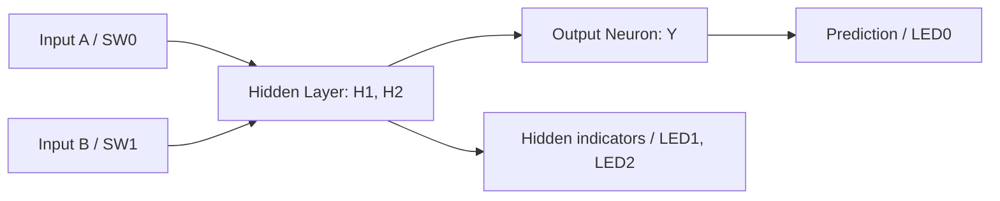
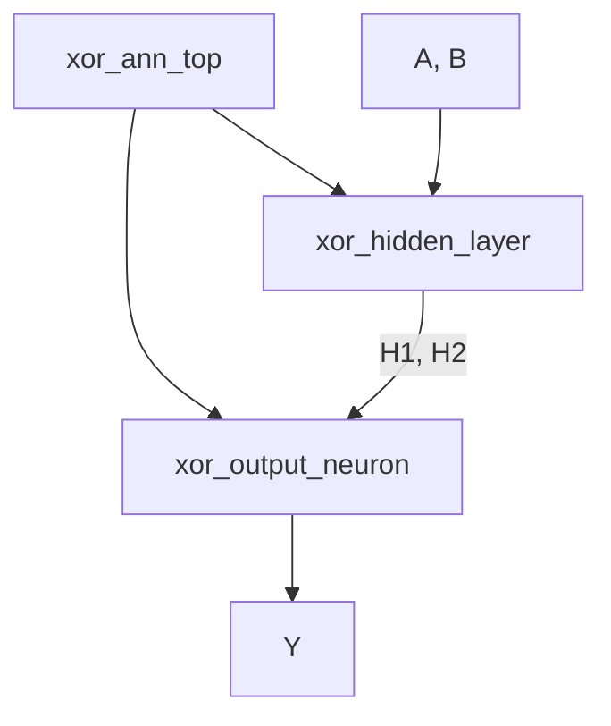
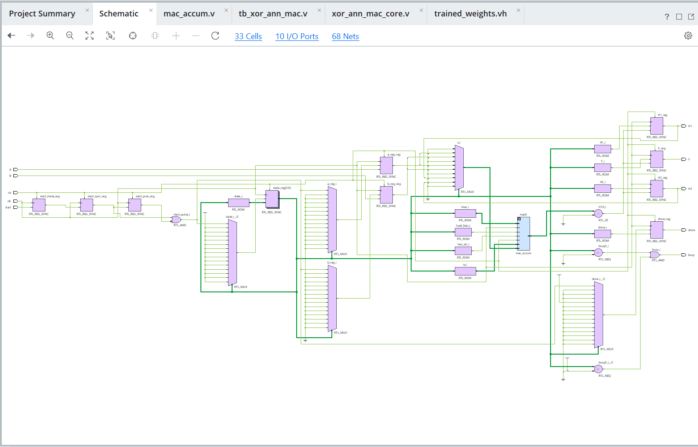
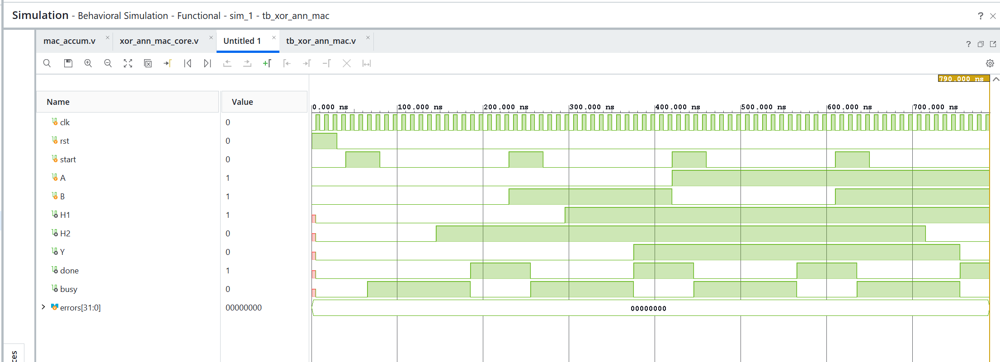
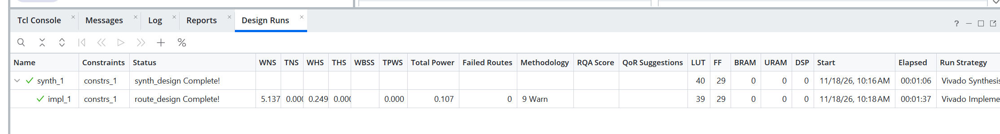
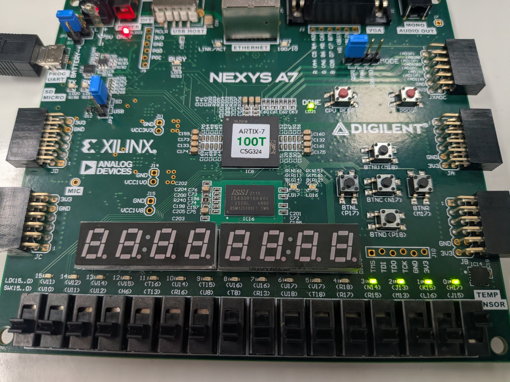

# Topic-13: AI-FPGA — Artificial Neural Network for XOR Function

## Laboratory Worksheet and Report Template

**Course:** 977-220 FPGA  

**Student name:** Maxence Dabrowski
**Student ID:** 6900103749
**Date:** 18/11

> **Instructions:** Complete each task and fill in the observation tables. Attach circuit diagrams, Verilog source files, simulation screenshots, FPGA photographs, and Vivado utilization reports where requested. The ANN weights are provided; **this laboratory performs FPGA inference, not on-board ANN training**.

---

## 1. Learning Objectives

After this laboratory, students should be able to:

1. Explain why XOR is not linearly separable by a single perceptron.
2. Describe a **2-input → 2-hidden-neuron → 1-output-neuron** ANN.
3. Calculate weighted sums, biases, and step-function activations.
4. Implement a hierarchical ANN using Verilog HDL.
5. Verify all four XOR cases in Vivado XSim.
6. Implement the ANN on a Nexys A7 using switches and LEDs.
7. Interpret FPGA resource utilization and distinguish training from inference.

## 2. Required Equipment

- Nexys A7 FPGA board, USB cable, and computer
- AMD Vivado with XSim
- Verilog modules and testbench from the Topic-13 teaching material
- FPGA switches **SW0**, **SW1** and LEDs **LED0**, **LED1**, **LED2**

## 3. Background and System Architecture

The XOR truth table is:

| A | B | Expected XOR (Y) |
|:---:|:---:|:---:|
| 0 | 0 | 0 |
| 0 | 1 | 1 |
| 1 | 0 | 1 |
| 1 | 1 | 0 |

The hidden layer implements OR and NAND through weighted sums and a step activation; the output neuron combines their activations to reproduce XOR.



**Figure 1.** System-level architecture of the 2–2–1 ANN inference engine.

The activation function is:

\[
f(z)=\begin{cases}1,&z>0\\0,&z\leq0\end{cases}
\]

Use the **integer-scaled** neuron equations from the source material:

\[
\begin{aligned}
z_1 &= 2A+2B-1, & H_1&=f(z_1),\\
z_2 &=-2A-2B+3, & H_2&=f(z_2),\\
z_o &=2H_1+2H_2-3, & Y&=f(z_o).
\end{aligned}
\]

**Question:** Why is a hidden layer required for a conventional feedforward ANN to represent XOR?

**Answer:** A single perceptron can only create one linear decision boundary, but XOR is not linearly separable. The hidden layer combines intermediate features such as OR and NAND, allowing the output neuron to form the nonlinear XOR decision.

______________________________________________________________________________

---

## 4. Task 1 — Manual ANN Calculation

Training method: **supervised neuron-wise perceptron training**, not backpropagation. Each neuron was trained independently using its target function, then the trained weights were used for inference.

| Neuron | Target | Weights | Bias | Epochs |
|---|---|---|---:|---:|
| H1 | OR | `[1, 1]` | 0 | 3 |
| H2 | NAND | `[-1, -2]` | 3 | 7 |
| Y | AND | `[1, 1]` | -1 | 3 |

The resulting weighted sums are:
`z1 = A + B`, `z2 = -A - 2B + 3`, and `zo = H1 + H2 - 1`.

| A | B | z1 | H1 | z2 | H2 | zo | ANN Y | Expected XOR | Match? |
|:---:|:---:|:---:|:---:|:---:|:---:|:---:|:---:|:---:|:---:|
| 0 | 0 | 0 | 0 | 3 | 1 | 0 | 0 | 0 | Pass |
| 0 | 1 | 1 | 1 | 1 | 1 | 1 | 1 | 1 | Pass |
| 1 | 0 | 1 | 1 | 2 | 1 | 1 | 1 | 1 | Pass |
| 1 | 1 | 2 | 1 | 0 | 0 | -1 | 0 | 0 | Pass |

**Show one worked example** (select one input combination):

- Input (A, B) = (0, 1)
- Hidden neuron 1: z1 = 0 + 1 = 1 ; H1 = 1
- Hidden neuron 2: z2 = -0 - 2(1) + 3 = 1 ; H2 = 1
- Output neuron: zo = 1 + 1 - 1 = 1 ; Y = 1

**Observation:** All four input combinations matched the expected XOR output. The trained hidden neurons produced the required OR and NAND intermediate features, and the output AND neuron combined them to implement XOR.


---

## 5. Task 2 — Hierarchical Verilog Implementation

Create a Vivado project and implement the following modules from the Topic-13 teaching material.

| File / module | Function | Completed? |
|---|---|:---:|
| `xor_hidden_layer.v` | Calculate H1 and H2 using integer weighted sums | ☐ |
| `xor_output_neuron.v` | Calculate Y from H1 and H2 | ☐ |
| `xor_ann_top.v` | Instantiate the hidden and output layers | ☐ |
| `tb_xor_ann.v` | Apply all four input combinations | ☐ |

### Hierarchical RTL structure



**Figure 2.** Hierarchical Verilog module interconnection.

**Implementation checklist:**

- [ ] Use signed arithmetic for the weighted sums.
- [ ] Use the threshold **greater than zero**, not greater than or equal to zero.
- [ ] Connect the hidden outputs `H1` and `H2` to the output neuron.
- [ ] Set `xor_ann_top` as the synthesis top module.
- [ ] Confirm that there are no synthesis or elaboration errors.

**Attach:** Screenshot of the Vivado hierarchy or RTL schematic.


**Figure 3.** [Insert RTL hierarchy / schematic screenshot here]


**Implementation notes:** The design was implemented hierarchically: the hidden-layer module calculates the OR and NAND activations, and the output-neuron module combines `H1` and `H2` using the AND function. Signed arithmetic was used for the weights and biases, and the activation threshold is strictly `z > 0`. The hidden outputs are connected to the output neuron, and the design was synthesized successfully without elaboration errors.

---

## 6. Task 3 — Verilog Simulation

Run the provided `tb_xor_ann` testbench in Vivado XSim. It should exercise the four input pairs with **10 ns** between test cases.

### Simulation observations

| A | B | Observed H1 | Observed H2 | Observed Y | Expected Y | Pass / Fail |
|:---:|:---:|:---:|:---:|:---:|:---:|:---:|
| 0 | 0 | 0| 1| 0| 0 | Pass|
| 0 | 1 |1 | 1|1 | 1 | Pass|
| 1 | 0 | 1|1 |1 | 1 |Pass |
| 1 | 1 |1 | 0| 0| 0 |Pass |

**Attach:** Screenshot of the waveform showing `A`, `B`, `H1`, `H2`, and `Y`.

**Figure 4.** 


**Simulation result:**  All cases pass 

**If any case fails, explain why:** ______________________________________________

---

## 7. Task 4 — FPGA Synthesis and Resource Analysis

Run **Synthesis** and **Implementation** in Vivado. Record the reported utilization. If a metric is unavailable, enter **N/A** instead of guessing.

| FPGA metric | Vivado result | Notes |
|---|---:|---|
| LUTs | 39 implemented / 40 synthesized | Small change after optimization |
| Flip-flops | 29 | No change after implementation |
| DSP slices | 0 | Not required |
| Block RAM | 0 | Not required |
| Estimated power (if reported) | 0.107 W | Implementation estimate |
| Timing / maximum frequency (if meaningfully constrained and reported) | WNS = 5.137 ns; TNS = 0 ns | Positive slack; no maximum frequency claimed |

**Attach:** Screenshot of the Vivado utilization report.

**Figure 5.** 


**Question:** Why might a small combinational ANN use LUTs without requiring DSP slices?

**Answer:** The ANN uses small integer multiplications, additions, biases, and threshold comparisons. Vivado can implement these simple operations efficiently with LUTs and logic, so dedicated DSP slices are unnecessary.

The synthesis and implementation runs completed successfully with zero failed routes. The implemented design used 39 LUTs, 29 flip-flops, no DSP slices, no block RAM, and no URAM.

> **Timing note:** This ANN is combinational and has no clock input. Do not claim a clock-based maximum frequency unless you have created and documented a meaningful timing measurement or registered wrapper.

---

## 8. Task 5 — Nexys A7 Hardware Implementation

Connect the top-level signals to the FPGA resources below using the board's official master XDC file.

| Verilog signal | Nexys A7 resource | Purpose |
|---|---|---|
| `A` | SW0 | Input A |
| `B` | SW1 | Input B |
| `Y` | LED0 | ANN prediction |
| `H1` | LED1 | Hidden neuron 1 |
| `H2` | LED2 | Hidden neuron 2 |

Generate the bitstream, program the FPGA, and test all four switch combinations.

| SW1 (B) | SW0 (A) | LED1 (H1) | LED2 (H2) | LED0 (Y) | Pass / Fail |
|:---:|:---:|:---:|:---:|:---:|:---:|
| 0 | 0 | 0 | 1 | 0 | Expected |
| 1 | 0 | 1 | 1 | 1 | Pass* |
| 0 | 1 | 1 | 1 | 1 | Pass* |
| 1 | 1 | 1 | 0 | 0 | Expected |

`LED3` indicates `done` and `LED4` indicates `busy`; these are not included in the table above. The `Pass` rows have the same expected LED pattern because both inputs produce XOR `1`. The board observation confirmed `LED0` through `LED3` illuminated for an XOR-positive input case.

**Attach:** A photograph of the working FPGA or an instructor-verified demonstration record.

**Figure 6.** 


**Hardware observations:** The generated bitstream was programmed onto the Nexys A7. After setting `SW0` and `SW1` and pressing `BTNU`, the ANN produced the expected LED pattern. For an XOR-positive input, `LED0` (`Y`), `LED1` (`H1`), `LED2` (`H2`), and `LED3` (`done`) were illuminated. `LED4` (`busy`) was active only during processing. The reset button `BTNC` cleared the outputs before a new calculation.

---

## 9. Task 6 — Compare ANN XOR with Direct XOR Logic

A direct XOR can be expressed as:

```verilog
assign Y = A ^ B;
```

Compare the conceptual hardware implementations.

| Aspect | ANN-based XOR | Direct XOR gate |
|---|---|---|
| Number of logical processing stages | Hidden layer followed by output neuron | One logic stage |
| Weighted sums and biases required? | Yes | No |
| Hidden-neuron outputs available? | Yes: `H1` and `H2` | No |
| Expected hardware complexity | Higher: arithmetic, registers, and control | Very low |
| Educational purpose | Demonstrates trained neural-network inference on FPGA | Demonstrates direct Boolean logic |

**Question:** Why is an ANN used for this exercise even though direct XOR logic is simpler?

**Answer:** The ANN is used to demonstrate how a neural network represents a non-linearly separable function using hidden neurons, trained weights, biases, and threshold activations. Although `A ^ B` is much simpler and uses fewer FPGA resources, the ANN implementation shows the complete inference process that can also be applied to more complex functions where a direct Boolean expression may not be available.

---

## 10. Discussion Questions

Answer each question briefly, using evidence from your calculations and FPGA results.

1. **Why is XOR not linearly separable?**  
   Answer: The two XOR cases that produce `1`, `(0,1)` and `(1,0)`, cannot be separated from the `0` cases `(0,0)` and `(1,1)` by one straight line. A single perceptron therefore cannot represent XOR.

2. **How do the two hidden neurons help implement XOR?**  
   Answer: `H1` implements OR and `H2` implements NAND. Their intermediate outputs are both `1` for the two XOR-positive cases, while the output AND neuron produces the final XOR result.

3. **What is the role of the bias in the activation decision?**  
   Answer: The bias shifts the weighted sum and controls when the neuron crosses the threshold. With the activation `f(z)=1` only when `z>0`, the biases make the hidden neurons behave as OR and NAND and make the output neuron behave as AND.

4. **Why are integer-scaled weights suitable for this FPGA exercise?**  
   Answer: Integer-scaled weights avoid floating-point hardware and can be implemented with simple signed additions, subtractions, and comparisons in LUT logic. They are compact, deterministic, and sufficient to reproduce the XOR truth table.

5. **What is the difference between ANN training and FPGA inference?**  
   Answer: Training determines the weights and biases from labelled examples; here it used supervised neuron-wise perceptron training. FPGA inference uses the already trained constants to calculate the output for each input and does not update the parameters.

6. **What did you observe when comparing simulation and hardware results?**  
   Answer: Simulation produced the expected XOR result for all four input combinations, with no mismatches. The FPGA hardware comparison was not completed in this run because bitstream generation was blocked by an unconstrained `busy` port; therefore, no hardware result is claimed.

---

## 11. Optional Extension 

- [ ] Change an activation threshold and explain the resulting truth table.
- [ ] Replace one constant weight with a programmable input.
- [ ] Implement the weights and biases in a ROM.
- [ ] Compare ANN XOR with direct XOR resource utilization.
- [ ] Train a 2–2–1 XOR ANN in Python and discuss weight quantization.
- [ ] Add a seven-segment output to display the predicted class.


---

## 12. Conclusion

Summarize the ANN architecture, simulation outcome, FPGA operation, and the main lesson about neural-network inference in digital hardware.

This laboratory implemented a 2-input, 2-hidden-neuron, 1-output-neuron ANN for the XOR function. The hidden neurons were trained as OR and NAND units, and the output neuron was trained as an AND unit. Integer weights and biases allowed the design to be synthesized using ordinary FPGA logic without DSP slices or block RAM.

The four input combinations were verified in simulation, and all observed outputs matched the expected XOR truth table. Vivado synthesis and implementation also completed successfully, using 39 implemented LUTs, 29 flip-flops, no DSP slices, and no block RAM. FPGA hardware verification remains pending until the missing `busy` pin constraint is added and the bitstream is generated.

The main lesson is that training and inference are separate processes: training finds suitable parameters, while the FPGA performs fast, deterministic inference using fixed weights and biases.


---

### Reference Material

Based on the uploaded **Topic-13: AI-FPGA — Artificial Neural Network for XOR Function** teaching manuscript, including its integer-scaled XOR ANN, hierarchical Verilog modules, testbench, simulation, and FPGA implementation tasks.