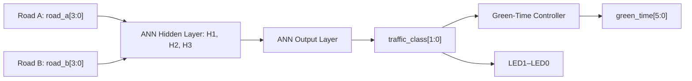
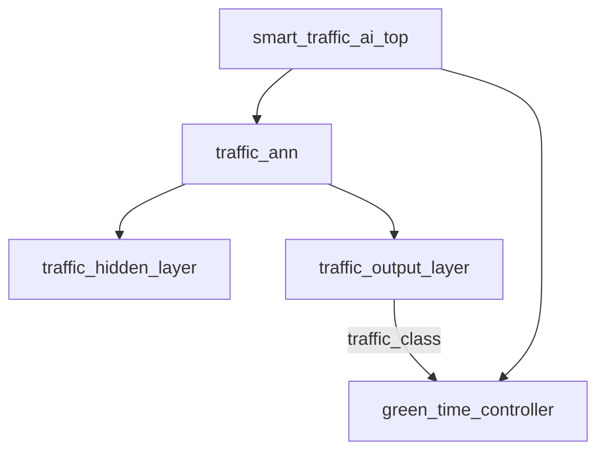
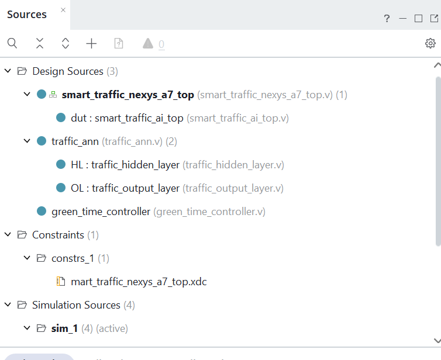
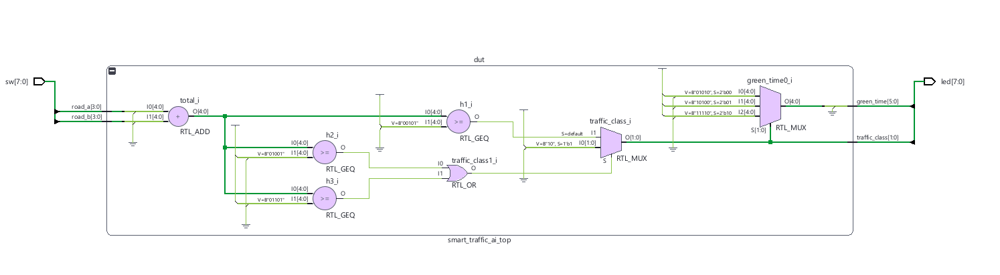
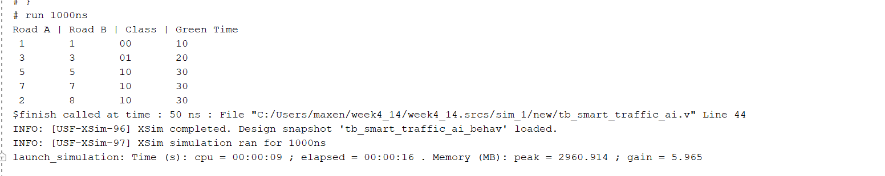
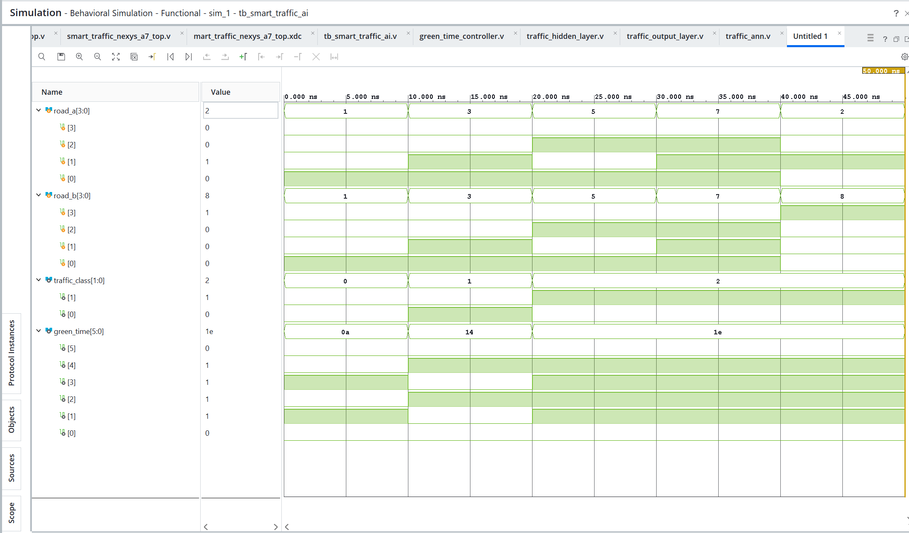
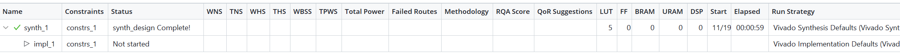
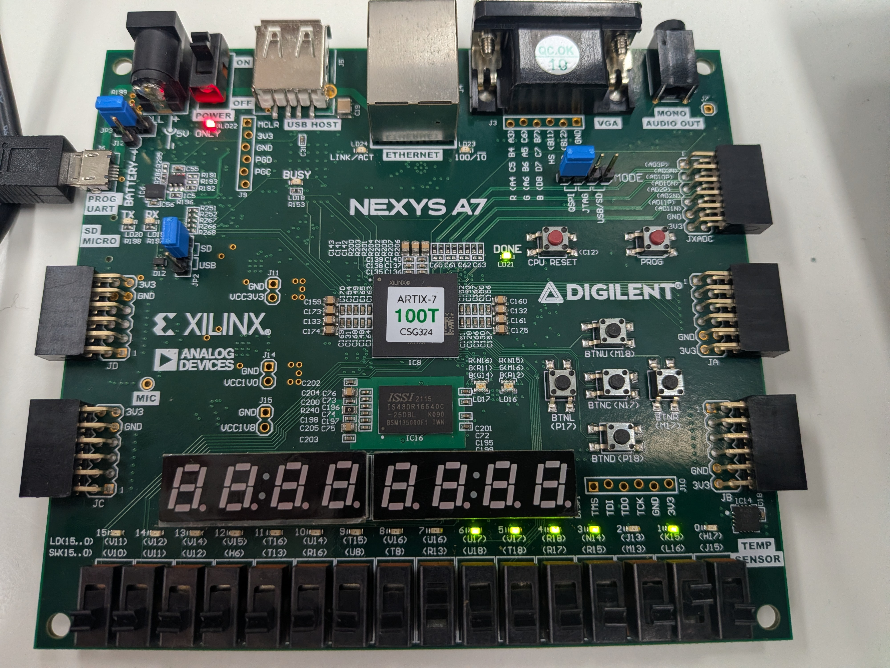

# Topic-14: AI-FPGA — ANN for Smart Traffic Control

## Laboratory Worksheet and Report Template

**Course:** 977-220 FPGA  

**Student name:** Maxence Dabrowski
**Student ID:** 6900103749
**Date:** 19/11

> **Instructions:** Complete the tables and questions as you perform the laboratory. Attach Verilog source files, simulation waveforms, Vivado reports, and FPGA demonstration evidence. Record *measured* results rather than assuming that expected results were observed. The source laboratory supplies an illustrative threshold-based ANN for FPGA **inference**; Python training is optional.

---

## 1. Learning Objectives

After completing the laboratory, students should be able to:

1. Explain a 2-input, 3-hidden-neuron, 2-output-neuron (2–3–2) ANN for traffic classification.
2. Calculate hidden-neuron thresholds and the resulting traffic class.
3. Implement hierarchical ANN inference and a green-time selection circuit in Verilog.
4. Verify the design using the `tb_smart_traffic_ai` testbench and Vivado XSim.
5. Deploy the design using FPGA switches and LEDs.
6. Record synthesis utilization and compare fixed-time versus adaptive green-time selection.
7. Distinguish a green-time **selection value** from an actual timed traffic-light FSM.

## 2. Equipment and Software

| Item | Purpose | Available? |
|---|---|:---:|
| FPGA board (Nexys A7 / Basys 3) | Hardware implementation | ☐ |
| USB cable and PC | Programming and development | ☐ |
| Vivado and XSim (or equivalent) | Design, simulation, synthesis | ☐ |
| Verilog HDL source files | ANN and timing selector | ☐ |
| FPGA switches and LEDs | Input and output demonstration | ☐ |
| 7-segment display (optional) | Display selected green time | ☐ |
| Python (optional) | Offline training and weight generation | ☐ |

## 3. Background: ANN-Based Traffic Classification

Two 4-bit inputs represent traffic levels on two roads:

- `road_a[3:0]` / `x1`: Road A traffic measurement (0–15).
- `road_b[3:0]` / `x2`: Road B traffic measurement (0–15).

The supplied design uses three hidden threshold neurons and a two-bit traffic-class output:

**Figure 1.** System-level data path. The source's `green_time_controller` selects a numeric duration; it does not itself implement a countdown or red/yellow/green FSM.

### 3.1 Traffic-class encoding

| `traffic_class` | Traffic condition | Selected `green_time` |
|:---:|---|---:|
| `2'b00` | Low | 10 s |
| `2'b01` | Medium | 20 s |
| `2'b10` | High | 30 s |
| `2'b11` | Reserved; controller defaults to 10 | 10 s (fallback) |

### 3.2 Hidden-neuron equations

The supplied simplified model is:

$$
H_1=f(x_1+x_2-4),\qquad
H_2=f(x_1+x_2-8),\qquad
H_3=f(x_1+x_2-12)
$$

with the step activation:

$$
f(z)=\begin{cases}1,&z>0\,  0,&z\leq0.\end{cases}
$$

Thus, in the supplied Verilog, `H1` is 1 when the sum is at least 5, `H2` at least 9, and `H3` at least 13. The output layer assigns **High** if `H3` or `H2` is active, **Medium** if only `H1` is active, and **Low** otherwise.

**Question 1:** Why is the hidden layer described as a set of traffic-density thresholds?

**Answer:** Each hidden neuron compares the combined traffic level `x1 + x2` with a different threshold. `H1`, `H2`, and `H3` become active when the total traffic reaches at least 5, 9, and 13, respectively, so they divide the traffic density into progressively higher ranges.

____________________________________________________________________________________

**Question 2:** What is the difference between ANN training and FPGA inference in this laboratory?

**Answer:** ANN training is the offline process of learning or selecting the weights and biases from labelled traffic examples. FPGA inference uses those fixed parameters in the Verilog circuit to classify the current road-traffic inputs and select a green-time value; the FPGA does not update the weights during operation.

____________________________________________________________________________________

---

## 4. Task 1 — Manual Calculation and ANN Simulation

### 4.1 Calculate the hidden-neuron states

For each test case, calculate `total = road_a + road_b`, the three hidden outputs, the two-bit class, and the selected green time. The five input pairs are taken from the source laboratory.

| Road A | Road B | Total | H1 | H2 | H3 | Expected class | Expected green time |
|---:|---:|---:|:---:|:---:|:---:|:---:|---:|
| 1 | 1 | 2 | 0 | 0 | 0 | `00` | 10 |
| 3 | 3 | 6 | 1 | 0 | 0 | `01` | 20 |
| 5 | 5 | 10 | 1 | 1 | 0 | `10` | 30 |
| 7 | 7 | 14 | 1 | 1 | 1 | `10` | 30 |
| 2 | 8 | 10 | 1 | 1 | 0 | `10` | 30 |

**Worked example:** Select one case and show each weighted sum / threshold decision.

- Road A = 5, Road B = 5, Total = 10
- `z1 = total − 4 = 6`; `H1 = 1`
- `z2 = total − 8 = 2`; `H2 = 1`
- `z3 = total − 12 = -2`; `H3 = 0`
- `traffic_class = 10`; `green_time = 30` seconds

### 4.2 Implement the hierarchical Verilog modules

| Module / file | Responsibility | Completed? |
|---|---|:---:|
| `traffic_hidden_layer.v` | Calculate H1, H2, H3 from the traffic inputs | ☐ |
| `traffic_output_layer.v` | Convert hidden states into `traffic_class` | ☐ |
| `traffic_ann.v` | Connect the hidden and output layers | ☐ |
| `green_time_controller.v` | Select 10, 20, or 30 seconds | ☐ |
| `smart_traffic_ai_top.v` | Integrate ANN and green-time selector | ☐ |
| `tb_smart_traffic_ai.v` | Apply traffic test cases | ☐ |

**Figure 2.** Verilog hierarchy from the source laboratory.

**Implementation checklist:**

- [x] Input widths are 4 bits per road; the intermediate traffic sum is wide enough for 0–30.
- [x] Hidden thresholds are `>= 5`, `>= 9`, and `>= 13` (equivalent to `f(z)` with `z > 0`).
- [x] The output layer prioritizes High, then Medium, then Low.
- [x] The `green_time_controller` implements `00 → 10`, `01 → 20`, `10 → 30`.
- [x] The top module connects `road_a`, `road_b`, `traffic_class`, and `green_time` correctly.
- [x] No elaboration or syntax errors are reported.

**Attach Figure 3:** Vivado hierarchy or RTL schematic screenshot.

**Figure 3.** Vivado hierarchy and RTL schematic for the smart traffic ANN.

### 4.3 Run the testbench

Use `tb_smart_traffic_ai` from the source lab. Record the actual results, not only the expected values. The source testbench changes the inputs at 10 ns intervals.

| Road A | Road B | Observed class | Observed green time | Expected class | Expected time | Pass / Fail |
|---:|---:|:---:|---:|:---:|---:|:---:|
| 1 | 1 |00 |10 | `00` | 10 | Pass|
| 3 | 3 |01 |20 | `01` | 20 |Pass |
| 5 | 5 |10 | 30| `10` | 30 | Pass|
| 7 | 7 | 10| 30| `10` | 30 |Pass |
| 2 | 8 |10 | 30| `10` | 30 | Pass|

**Attach Figure 4:** XSim waveform showing `road_a`, `road_b`, `traffic_class`, and `green_time`; show hidden states if available.

**Figure 4.** XSim waveform and simulation results.

**Simulation result:** ☑ All cases pass

**If any case fails, explain the observed behavior:** No cases failed; all five observed class and green-time values matched the expected results.

____________________________________________________________________________________

### 4.4 Boundary verification (additional analysis)

Test inputs around the decision boundaries. These are supplementary cases for examining the source's threshold behavior.

| Road A | Road B | Total | Expected class | Expected green time | Observed class | Pass / Fail |
|---:|---:|---:|:---:|---:|:---:|:---:|
| 2 | 2 | 4 | `00` | 10 |00 |Pass |
| 2 | 3 | 5 | `01` | 20 |01 |Pass |
| 4 | 4 | 8 | `01` | 20 |01 |Pass |
| 4 | 5 | 9 | `10` | 30 |10 |Pass |
| 6 | 6 | 12 | `10` | 30 |10 | Pass|
| 6 | 7 | 13 | `10` | 30 |10 |Pass |

**Question:** Why does the traffic class remain High when the sum changes from 12 to 13?

**Answer:** The High class is already selected at a total of 12 because `H2` is active. Increasing the total to 13 activates `H3` as well, but the output layer still prioritizes High, so the class remains `2'b10` and the selected green time remains 30 seconds.

---

## 5. Task 2 — FPGA Synthesis and Resource Analysis

Run synthesis for `smart_traffic_ai_top` and inspect the Vivado reports. Use the same board/part for all comparisons.

| FPGA resource / metric | Vivado reported result | Notes |
|---|---:|---|
| LUTs | 5 | Synthesis result |
| Flip-flops | 0 | Synthesis result |
| DSP slices | 0 | Not required for threshold comparisons |
| Block RAM | 0 | Not required |
| I/O pins | N/A | Not reported in the supplied synthesis summary |
| Estimated power (if available) | N/A | Not reported |
| Timing / Fmax (only if meaningfully constrained) | N/A | The combinational top has no clock constraint |

**Attach Figure 5:** Synthesis utilization report.

**Figure 5.** Vivado Design Runs synthesis summary for `smart_traffic_ai_top`.

**Question:** Why might this small threshold-based combinational ANN use LUTs without DSP slices?

**Answer:** The hidden layer only performs additions, subtractions, and comparisons against constant thresholds. These small operations map efficiently to LUTs and do not require the dedicated multiplier hardware provided by DSP slices. The synthesis report confirms this implementation uses 5 LUTs and 0 DSP slices.

> **Timing note:** The supplied `smart_traffic_ai_top` is combinational and has no clock input. Do not report a clock-based Fmax for this unregistered top unless you add and document an appropriate clocked wrapper or timing measurement. Enter N/A when not applicable.

---

## 6. Task 3 — FPGA Hardware Testing

Use the board's **official master XDC** to assign input switches and output LEDs. The source provides logical resource assignments but not physical package-pin constraints.

| Verilog signal | FPGA resource | Purpose | Verified? |
|---|---|---|:---:|
| `road_a[3:0]` | SW3–SW0 | Road A traffic | ☑ |
| `road_b[3:0]` | SW7–SW4 | Road B traffic | ☑ |
| `traffic_class[0]` | LED0 | Class bit 0 | ☑ |
| `traffic_class[1]` | LED1 | Class bit 1 | ☑ |
| `green_time[5:0]` | LED7–LED2 | Green-time value in binary | ☑ |

**Hardware verification table**

| SW7–SW4 (Road B) | SW3–SW0 (Road A) | Expected class | LED1 LED0 observed | Pass / Fail |
|---|---|:---:|:---:|:---:|
| `0001` | `0001` | `00` |00 |Pass |
| `0011` | `0011` | `01` | 01|Pass |
| `0101` | `0101` | `10` |10 | Pass|
| `0111` | `0111` | `10` |10 |Pass |
| `1000` | `0010` | `10` | 10| Pass|

**Attach Figure 6:** FPGA photograph or instructor-verified demonstration evidence.

**Figure 6.** 

**Hardware observations:** The bitstream was programmed onto the Nexys A7 and all five supplied input combinations were tested. The observed class bits matched the expected values: `00` for low traffic, `01` for medium traffic, and `10` for high traffic. The green-time value is displayed on LED7–LED2 as a six-bit binary number; for example, 10 seconds appears as `001010`.

---

## 7. Task 4 — Adaptive Green-Time Selection

Verify the mapping implemented by `green_time_controller`.

| `traffic_class` | Expected `green_time` | Observed `green_time` | Pass / Fail |
|:---:|---:|---:|:---:|
| `00` | 10 |10 |Pass |
| `01` | 20 |20 |Pass |
| `10` | 30 |30 |Pass |
| `11` (reserved/fallback) | 10 | 10 (fallback) | Pass |

**Question 1:** What happens to the selected green time when the traffic class changes from Low to High?

**Answer:** The selected green time increases from 10 seconds for Low traffic to 30 seconds for High traffic, giving high total traffic a longer green interval.

**Question 2:** Does the supplied design directly drive red, yellow, and green lamps for 10, 20, and 30 real seconds? Explain.

**Answer:** No. The supplied design is combinational and only outputs a numeric duration. It does not contain a clock divider, countdown timer, or red/yellow/green FSM, so the value is not a real-time lamp control signal.

**Extension idea (optional):** Add a clock divider/counter and a traffic-light FSM (`RED → GREEN → YELLOW → RED`) to turn the selected numeric duration into real timed control. This functionality is **not implemented** by the supplied combinational top module.

---

## 8. Task 5 — Fixed-Time vs ANN-Based Adaptive Controller

The source compares a fixed-time example of **20 seconds** with the ANN's class-dependent selection. Complete the table.

| Traffic condition | Fixed-time green selection | ANN green selection | Difference (ANN − Fixed) |
|---|---:|---:|---:|
| Low | 20 s | 10 s | -10s|
| Medium | 20 s | 20 s | 0s|
| High | 20 s | 30 s |10s |

**Question 1:** Which traffic condition receives a shorter green time under ANN-based selection?

**Answer:** Low traffic receives the shorter ANN-selected green time of 10 seconds instead of the fixed 20 seconds.

**Question 2:** What is a limitation of using only the **sum** of Road A and Road B traffic measurements?

**Answer:** The sum loses information about distribution. For example, `(2,8)` and `(5,5)` both total 10 and receive the same class, even though one road may need priority over the other.

**Question 3:** Why is selecting one duration not sufficient for a complete two-road intersection controller?

**Answer:** A complete intersection controller must decide which road receives the green light, enforce safe red/yellow transitions, and count the selected duration. This design only selects a duration and does not implement those control functions.

**Comparison summary:** The ANN adapts the numeric green-time selection to total traffic: it shortens Low traffic to 10 seconds, keeps Medium traffic at 20 seconds, and extends High traffic to 30 seconds. The fixed-time controller always uses 20 seconds, but neither approach alone implements the complete intersection FSM.

---

## 9. Discussion Questions

Answer using your calculations, simulation results, and hardware evidence.

1. **Why is ANN training usually performed offline rather than on a small FPGA?**  
   Answer: Training requires repeated weight updates, labelled data, memory, and more arithmetic than this small inference circuit. Offline training produces fixed parameters that the FPGA can use efficiently.

2. **What is the difference between ANN training and ANN inference?**  
   Answer: Training learns weights and biases from examples, while inference applies fixed weights and biases to new inputs to produce a classification and green-time selection.

3. **Why can integer/fixed-point arithmetic simplify an FPGA ANN?**  
   Answer: It avoids floating-point hardware and allows additions, comparisons, and constant thresholds to be implemented with simple FPGA logic.

4. **How could reducing weight precision affect ANN classification accuracy?**  
   Answer: Quantization reduces numerical resolution and can move a weighted sum across a threshold, causing an incorrect traffic class, especially for inputs near a boundary.

5. **What happens if the traffic measurements fall outside the training data or assumed operating range?**  
   Answer: The fixed thresholds still produce a class, but the result may not represent the real traffic condition because the design has not been validated for that range.

6. **How could cameras or physical traffic sensors replace the switches?**  
   Answer: A sensor interface could measure vehicle density, quantize each measurement to four bits, and provide those values to `road_a` and `road_b` instead of manual switch inputs.

7. **What potential advantages does an FPGA offer for real-time neural-network inference?**  
   Answer: FPGAs provide deterministic low-latency parallel hardware, configurable I/O, and efficient implementation of fixed-point arithmetic with low power for small models.

8. **How could multiple intersections exchange traffic information?**  
   Answer: Each controller could transmit traffic measurements or selected classes through a wired or wireless network, allowing neighboring controllers to coordinate timing and avoid transferring congestion downstream.

---

## 10. Optional Extension 

- [ ] Implement four traffic classes: Very Low, Low, Medium, High.
- [ ] Add a third road input `X3` and revise the ANN.
- [ ] Train an ANN in Python and export weights and biases to Verilog.
- [ ] Compare 16-bit, 8-bit, and 4-bit quantized weights.
- [ ] Implement a timed `RED → GREEN → YELLOW → RED` FSM.
- [ ] Display `green_time` using a 7-segment display driver.
- [ ] Compare FPGA resource utilization between two implementations.
- [ ] Extend the controller to choose both the road and its green-light duration.

---

## 11. Conclusion

Summarize the 2–3–2 ANN architecture, threshold calculations, simulation outcome, FPGA implementation, green-time selection, and the main design limitation.

This laboratory implemented a 2–3–2 threshold ANN for traffic classification. Three hidden neurons compare the total of two four-bit road measurements with thresholds of 5, 9, and 13. The output layer maps these states to Low, Medium, or High traffic, and the controller selects 10, 20, or 30 seconds.

The five simulation cases and the boundary cases matched the expected classes and green-time values. The design synthesized to 5 LUTs, 0 flip-flops, 0 DSP slices, and 0 block RAM. On the Nexys A7, the switch inputs and LED class outputs were verified for all five supplied cases, and the green-time value was displayed in binary on LED7–LED2.

The main limitation is that the design selects a duration only. It does not identify which road receives the green light and does not implement a clocked countdown or a red/yellow/green FSM. A complete traffic controller would add those timing and safety-control functions.

---

### Source and scope

This worksheet is adapted from **Topic-14: AI-FPGA — ANN for Smart Traffic Control**, `977-220/fpga-2026/week-4/slot-14/README.md`. The threshold equations, module names, five original test cases, traffic-class mapping, switch/LED mapping, and five laboratory tasks follow that source. Boundary tests, expanded observation tables, and the explicit distinction between duration selection and a timed FSM are supplementary reporting aids.